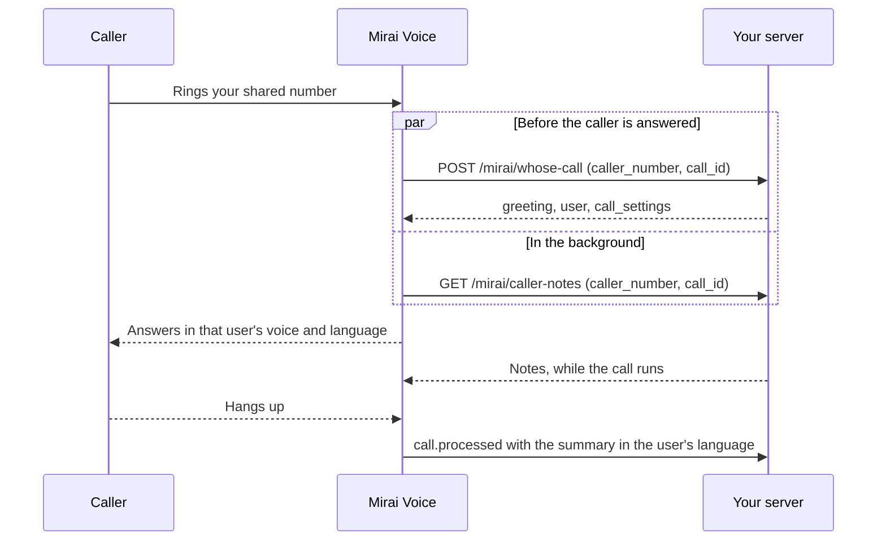

This recipe answers one phone number on behalf of many of your users. Every
call reaches the same agent, and before the caller is answered your server
says whose call it is. The agent then greets the caller for that user, speaks
in that user's voice and language, and writes the summary in the language the
user reads. Call-screening apps, shared support lines, personal assistant
numbers and any app that gives many accounts one number follow the same
pattern.

## What you'll build

- A shared number whose calls go to one agent.
- A lookup on your server that answers within two seconds: whose call it is,
  the greeting, and the voice and languages for that user. When it says "not
  ours", or can't answer in time, the caller is not answered and nothing is
  charged.
- A background lookup for slower data, such as notes about the caller. Its
  values reach the agent during the call.
- A summary of each call in the user's own language, delivered to your
  webhook.
- A way for your app to end a call while it runs.

You need:

- A workspace API key and its webhook secret. See the [Quickstart](/v2/quickstart).
- A phone number in your workspace that answers incoming calls. The
  [inbound calling cookbook](/cookbooks/inbound-calling) covers buying or
  connecting one.
- A public HTTPS server on port 443 for the lookups and the webhook. While you
  build, a tunnel to your laptop works.
- Python 3.10+ with FastAPI and `httpx`, or Node.js 18+ with Express. The
  setup steps also work with cURL and `jq`.

## How it works



The caller is ringing while your lookup runs, so time matters:

| When | What happens |
| :--- | :--- |
| 0 s | The caller rings your number. Both lookups start. |
| Within about 2 s | Your `whose-call` lookup answers. The call takes its greeting, voice and languages. A "not ours" answer, an error or a slow answer means the caller is not answered. |
| Answer | The agent greets the caller for that user, in that user's voice. |
| Up to 2 minutes | `caller-notes` answers. The agent uses its values from its next reply. |
| After hangup | Analysis writes the summary in the user's language, and `call.processed` reaches your webhook. |

The two-second budget is shared by every pre-call tool the call waits for. The
[Tools page](/v2/tools#personalize-the-greeting) explains how it works on
incoming calls.

## Step 1: Answer "whose call is it?" on your server

Each incoming call sends your server the caller's number (`caller_number`), the
number they dialled (`called_number`) and the call's `id`. Your server decides
whose call it is from those and your own records, and answers with:

| Key | Used for |
| :--- | :--- |
| `answer` | `false` turns the call away. The caller is not answered. |
| `user_id`, `owner_name` | The prompt, and your own records. |
| `greeting` | The agent's first words, spoken as you send them. |
| `instructions` | A few lines about this user that go into the prompt. |
| `reply_language`, `summary_language` | The language the agent replies in, and the one the summary is written in, as words (`Hindi`, `Gujarati`). |
| `call_settings` | The voice and languages for this call. See [call settings](/v2/calls#call-settings). |

Each value you want in the prompt is at most 512 characters, so keep
`instructions` short. Save the call `id` against the user: the webhook in
step 4 uses it to find whose call it was.

The second route serves the background lookup. It starts at the same moment
as the first, so it works the user out again instead of waiting for the first
request to finish.

Both routes check a shared key that Mirai sends in the `Authorization` header.
`db`, `crm` and `verify_mirai_signature` stand in for your own code.

<Tabs>
  <Tab title="Python">
    ```python title="server.py"
    import hmac
    import json
    import os

    from fastapi import FastAPI, Header, HTTPException, Request
    from pydantic import BaseModel

    app = FastAPI()
    LOOKUP_KEY = os.environ["MIRAI_LOOKUP_KEY"]  # the value you store as the lookup_key secret


    def check_key(authorization: str | None) -> None:
        expected = f"Bearer {LOOKUP_KEY}"
        if not hmac.compare_digest(authorization or "", expected):
            raise HTTPException(status_code=401)


    class IncomingCall(BaseModel):
        call_id: str
        caller_number: str
        called_number: str


    @app.post("/mirai/whose-call")
    def whose_call(body: IncomingCall, authorization: str | None = Header(default=None)):
        check_key(authorization)
        # Stand-in: your user lookup. Keep it to an indexed read; the caller is ringing.
        user = db.users.for_incoming_call(body.caller_number, body.called_number)
        if user is None:
            return {"answer": False}
        db.calls.save(call_id=body.call_id, user_id=user.id)
        return {
            "answer": True,
            "user_id": user.id,
            "owner_name": user.first_name,
            "greeting": user.greeting,  # "Namaste, Asha ji ka assistant bol raha hoon. Aap kaun?"
            "instructions": user.instructions[:500],
            "reply_language": user.reply_language,  # "Hindi"
            "summary_language": user.summary_language,  # "English"
            "call_settings": {
                "voice_id": user.voice_id,  # "neha"
                "language": user.language,  # "hi"
                "secondary_languages": user.secondary_languages,  # ["en"]
            },
        }


    @app.get("/mirai/caller-notes")
    def caller_notes(call_id: str, caller_number: str, called_number: str,
                     authorization: str | None = Header(default=None)):
        check_key(authorization)
        # This request starts together with /whose-call, so look the user up again.
        user = db.users.for_incoming_call(caller_number, called_number)
        if user is None:
            return {}
        notes = crm.notes_about(user.id, caller_number)  # stand-in; can take seconds
        return {"caller_name": notes.name, "last_message": notes.last_message}


    @app.post("/mirai/events")
    async def events(request: Request):
        raw = await request.body()
        verify_mirai_signature(raw, request.headers)  # stand-in: see Webhooks, signature verification
        event = json.loads(raw)
        if event["type"] == "call.processed":
            call = event["data"]["call"]
            saved = db.calls.get(call["id"])
            if saved and call.get("analysis"):
                db.messages.add(user_id=saved.user_id, call_id=call["id"],
                                summary=call["analysis"].get("summary"),
                                data=call["analysis"].get("data", {}))
        return {"ok": True}
    ```
  </Tab>
  <Tab title="Node.js">
    ```javascript title="server.js"
    import express from "express";
    import { timingSafeEqual } from "node:crypto";

    const app = express();
    const expected = Buffer.from(`Bearer ${process.env.MIRAI_LOOKUP_KEY}`);

    function fromMirai(req) {
      const got = Buffer.from(req.get("Authorization") ?? "");
      return got.length === expected.length && timingSafeEqual(got, expected);
    }

    app.post("/mirai/whose-call", express.json(), async (req, res) => {
      if (!fromMirai(req)) return res.sendStatus(401);
      const { call_id, caller_number, called_number } = req.body;
      // Stand-in: your user lookup. Keep it to an indexed read; the caller is ringing.
      const user = await db.users.forIncomingCall(caller_number, called_number);
      if (!user) return res.json({ answer: false });
      await db.calls.save({ callId: call_id, userId: user.id });
      res.json({
        answer: true,
        user_id: user.id,
        owner_name: user.firstName,
        greeting: user.greeting, // "Namaste, Asha ji ka assistant bol raha hoon. Aap kaun?"
        instructions: user.instructions.slice(0, 500),
        reply_language: user.replyLanguage, // "Hindi"
        summary_language: user.summaryLanguage, // "English"
        call_settings: {
          voice_id: user.voiceId, // "neha"
          language: user.language, // "hi"
          secondary_languages: user.secondaryLanguages, // ["en"]
        },
      });
    });

    app.get("/mirai/caller-notes", async (req, res) => {
      if (!fromMirai(req)) return res.sendStatus(401);
      const { caller_number, called_number } = req.query;
      // This request starts together with /whose-call, so look the user up again.
      const user = await db.users.forIncomingCall(caller_number, called_number);
      if (!user) return res.json({});
      const notes = await crm.notesAbout(user.id, caller_number); // stand-in; can take seconds
      res.json({ caller_name: notes.name, last_message: notes.lastMessage });
    });

    app.post("/mirai/events", express.raw({ type: "application/json" }), async (req, res) => {
      verifyMiraiSignature(req.body, req.headers); // stand-in: see Webhooks, signature verification
      const event = JSON.parse(req.body);
      if (event.type === "call.processed") {
        const call = event.data.call;
        const saved = await db.calls.get(call.id);
        if (saved && call.analysis) {
          await db.messages.add({
            userId: saved.userId,
            callId: call.id,
            summary: call.analysis.summary,
            data: call.analysis.data ?? {},
          });
        }
      }
      res.json({ ok: true });
    });

    app.listen(3000);
    ```
  </Tab>
</Tabs>

A user who prefers Gujarati gets a different answer from the same route, and
the same agent sounds different on their calls:

```json
{
  "answer": true,
  "user_id": "usr_2087",
  "owner_name": "Mehul",
  "greeting": "Kem cho, Mehul bhai na assistant sathe vaat karo cho. Aap kon?",
  "instructions": "Mehul is travelling this week. Take a message and the best time to call back.",
  "reply_language": "Gujarati",
  "summary_language": "Gujarati",
  "call_settings": { "voice_id": "sameer", "language": "gu", "secondary_languages": ["hi", "en"] }
}
```

For signature checks on `/mirai/events`, see
[signature verification](/v2/webhooks#signature-verification).

## Step 2: Create the agent

Save this as `shared-line-agent.json`, with your server's address in place of
`api.example.com`.

```json title="shared-line-agent.json"
{
  "name": "Shared line assistant",
  "first_message": "{{owner.greeting}}",
  "system_prompt": "You answer phone calls for {{owner.owner_name}}. The caller is calling from {{caller_number}}. Find out who is calling and why, and take a short message. {{owner.instructions}} Reply in {{owner.reply_language}}, and switch if the caller does. Never share {{owner.owner_name}}'s personal details or say where they are. Keep replies to one or two short sentences. When you have the message, thank the caller and end the call.",
  "voice": { "voice_id": "neha" },
  "language": "hi",
  "secondary_languages": ["en"],
  "max_duration_secs": 300,
  "draft": false,
  "end_call": { "enabled": true, "confirm": true },
  "tools": [
    {
      "name": "owner",
      "phase": "pre_call",
      "request": {
        "method": "POST",
        "url": "https://api.example.com/mirai/whose-call",
        "headers": { "Authorization": "Bearer {{ secrets.lookup_key }}" },
        "body": {
          "call_id": "{{ call.id }}",
          "caller_number": "{{ vars.caller_number }}",
          "called_number": "{{ vars.called_number }}"
        }
      },
      "response": {
        "select": ["answer", "user_id", "owner_name", "greeting", "instructions", "reply_language", "summary_language"]
      },
      "timeout_ms": 1500,
      "on_failure": "abort"
    },
    {
      "name": "skip_call",
      "phase": "pre_call",
      "condition": { "field": "vars.owner.answer", "op": "is_false" },
      "builtin": { "reason": "Not one of our users' calls" }
    },
    {
      "name": "notes",
      "phase": "pre_call",
      "execution": "async",
      "on_failure": "continue",
      "timeout_ms": 60000,
      "request": {
        "url": "https://api.example.com/mirai/caller-notes",
        "headers": { "Authorization": "Bearer {{ secrets.lookup_key }}" },
        "query": {
          "call_id": "{{ call.id }}",
          "caller_number": "{{ vars.caller_number }}",
          "called_number": "{{ vars.called_number }}"
        }
      },
      "response": { "select": ["caller_name", "last_message"] }
    }
  ],
  "analysis": {
    "enabled": true,
    "prompt": "Summarise the call for {{owner.owner_name}} in two or three sentences: who called, why, and what they asked for. Write the summary in {{owner.summary_language}}.",
    "success_criteria": "The caller's name and the reason for the call were both captured.",
    "output_schema": {
      "type": "object",
      "properties": {
        "caller_name": { "type": "string" },
        "reason": { "type": "string" },
        "callback_requested": { "type": "boolean" }
      }
    }
  }
}
```

What each part does:

- `owner` waits for your answer. Its `timeout_ms` of 1.5 seconds leaves room
  inside the incoming-call budget, and `on_failure: "abort"` means a caller
  is never answered with a greeting that has no user in it. A call your
  server couldn't answer ends `failed` with
  [`precall-tool-failed`](/v2/calls#ended-reasons).
- The `call_settings` in your answer set the voice and languages. `select`
  doesn't need to name them. See
  [Set the voice and language for the call](/v2/tools#set-the-voice-and-language-for-the-call).
- `skip_call` runs after `owner` and turns the call away when your server
  answered `"answer": false`. The call ends `aborted` with
  `skipped-by-condition`, and nothing is charged.
- `notes` runs in the background, so it never holds the answer. It reads the
  call's own variables only: a background tool can't read `owner`'s values,
  because both start together. When it answers, the agent gets the caller's
  name and last message. See
  [Run a slow lookup in the background](/v2/tools#run-a-slow-lookup-in-the-background).
- `analysis.prompt` reads `{{owner.summary_language}}`, so each summary is
  written in that user's language. See
  [Variables in the prompt](/v2/analysis#variables-in-the-prompt).
- The agent's own `voice` and `language` are what a call uses when your answer
  leaves `call_settings` out.

## Step 3: Store the key, create the agent and point the number at it

Store the key your server checks as a workspace secret, create the agent, then
assign it to the number with a webhook. The number update needs its current
`version`.

<Tabs>
  <Tab title="cURL">
    ```bash
    set -euo pipefail
    : "${MIRAI_API_BASE:?}" "${MIRAI_API_KEY:?}" "${MIRAI_LOOKUP_KEY:?}" "${NUMBER_ID:?}"
    AUTH="Authorization: Bearer $MIRAI_API_KEY"

    jq -n '{value: env.MIRAI_LOOKUP_KEY}' |
      curl --fail-with-body -sS -X PUT "$MIRAI_API_BASE/v2/secrets/lookup_key" \
        -H "$AUTH" -H 'Content-Type: application/json' --data-binary @- > /dev/null

    AGENT_ID=$(curl --fail-with-body -sS "$MIRAI_API_BASE/v2/agents" \
      -H "$AUTH" -H 'Content-Type: application/json' \
      --data-binary @shared-line-agent.json | jq -er '.id')

    NUMBER=$(curl --fail-with-body -sS "$MIRAI_API_BASE/v2/phone-numbers/$NUMBER_ID" -H "$AUTH")
    jq --arg agent "$AGENT_ID" --arg url "https://api.example.com/mirai/events" \
      '{version, agent_id: $agent, webhook_url: $url}' <<< "$NUMBER" |
      curl --fail-with-body -sS -X PATCH "$MIRAI_API_BASE/v2/phone-numbers/$NUMBER_ID" \
        -H "$AUTH" -H 'Content-Type: application/json' --data-binary @- |
      jq '{id, number, agent_id, state}'
    ```
  </Tab>
  <Tab title="Python">
    ```python
    import json
    import os
    from pathlib import Path

    import httpx

    api = httpx.Client(
        base_url=os.environ["MIRAI_API_BASE"],
        headers={"Authorization": f"Bearer {os.environ['MIRAI_API_KEY']}"},
        timeout=30,
    )

    api.put("/v2/secrets/lookup_key",
            json={"value": os.environ["MIRAI_LOOKUP_KEY"]}).raise_for_status()

    agent = api.post("/v2/agents",
                     json=json.loads(Path("shared-line-agent.json").read_text()))
    agent.raise_for_status()
    agent_id = agent.json()["id"]

    number_id = os.environ["NUMBER_ID"]
    number = api.get(f"/v2/phone-numbers/{number_id}").raise_for_status().json()
    number = api.patch(f"/v2/phone-numbers/{number_id}", json={
        "version": number["version"],
        "agent_id": agent_id,
        "webhook_url": "https://api.example.com/mirai/events",
    }).raise_for_status().json()
    print(number["number"], number["agent_id"], number["state"])
    ```
  </Tab>
  <Tab title="Node.js">
    ```javascript
    import { readFile } from "node:fs/promises";

    const { MIRAI_API_BASE, MIRAI_API_KEY, MIRAI_LOOKUP_KEY, NUMBER_ID } = process.env;

    async function api(method, path, body) {
      const res = await fetch(`${MIRAI_API_BASE}${path}`, {
        method,
        headers: { Authorization: `Bearer ${MIRAI_API_KEY}`, "Content-Type": "application/json" },
        body: body === undefined ? undefined : typeof body === "string" ? body : JSON.stringify(body),
      });
      const json = await res.json();
      if (!res.ok) throw new Error(`${method} ${path}: ${JSON.stringify(json)}`);
      return json;
    }

    await api("PUT", "/v2/secrets/lookup_key", { value: MIRAI_LOOKUP_KEY });
    const agent = await api("POST", "/v2/agents", await readFile("shared-line-agent.json", "utf8"));

    const current = await api("GET", `/v2/phone-numbers/${NUMBER_ID}`);
    const number = await api("PATCH", `/v2/phone-numbers/${NUMBER_ID}`, {
      version: current.version,
      agent_id: agent.id,
      webhook_url: "https://api.example.com/mirai/events",
    });
    console.log(number.number, number.agent_id, number.state);
    ```
  </Tab>
</Tabs>

If the number has never answered calls, activate it first. The
[inbound calling cookbook](/cookbooks/inbound-calling#4-assign-your-agent-and-activate-incoming-calls)
shows how, and [its step 5](/cookbooks/inbound-calling#5-receive-events-and-read-results)
says which secret signs the number's webhooks.

## Step 4: Read each call's result

Every call carries the voice and languages it used, and who chose each, in
[`call_settings`](/v2/calls#on-the-call-object). On a call your server
configured, the sources name your tool:

```json
{
  "id": "call_01K8F2A7C9E1G3J5L7N9Q1S3U5",
  "direction": "inbound",
  "from": "+919876543210",
  "status": "completed",
  "call_settings": {
    "voice_id": "sameer",
    "language": "gu",
    "secondary_languages": ["hi", "en"],
    "sources": { "voice_id": "pre_call:owner", "language": "pre_call:owner", "secondary_languages": "pre_call:owner" }
  }
}
```

After the call, `call.processed` brings the summary in `data.call.analysis`.
The `/mirai/events` route in step 1 finds the user from the call `id` it saved
and stores the message. A call your server turned away sends `call.aborted`
(`skipped-by-condition`) or `call.failed` (`precall-tool-failed`) and no
summary.

To show a call while it runs, open its [live events](/v2/live-events) with your
key from the moment `whose-call` gives you the call `id`. The pre-call tools'
events arrive while the caller's phone is still ringing.

## Step 5: End a call from your app

Your app has the call `id` from the lookup, so it can end a call at any time,
for example when your user picks up elsewhere or blocks the caller.

<Tabs>
  <Tab title="cURL">
    ```bash
    curl --fail-with-body -X POST "$MIRAI_API_BASE/v2/calls/$CALL_ID/abort" \
      -H "Authorization: Bearer $MIRAI_API_KEY"
    ```
  </Tab>
  <Tab title="Python">
    ```python
    import os

    import httpx

    r = httpx.post(
        f"{os.environ['MIRAI_API_BASE']}/v2/calls/{call_id}/abort",
        headers={"Authorization": f"Bearer {os.environ['MIRAI_API_KEY']}"},
        timeout=30,
    )
    if r.status_code != 409:  # 409: the call had already ended
        r.raise_for_status()
    ```
  </Tab>
  <Tab title="Node.js">
    ```javascript
    const res = await fetch(`${process.env.MIRAI_API_BASE}/v2/calls/${callId}/abort`, {
      method: "POST",
      headers: { Authorization: `Bearer ${process.env.MIRAI_API_KEY}` },
    });
    if (!res.ok && res.status !== 409) throw new Error(`abort failed: ${res.status}`); // 409: already ended
    ```
  </Tab>
</Tabs>

The call hangs up at once, without a goodbye, and ends `aborted` with
`aborted-by-api`. See [Abort a call](/v2/calls#abort-a-call).

## Test it

This test agent needs no server of your own. It uses
[httpbin.org](https://httpbin.org), a public echo service, in place of both
lookups. Anything you send it is public, and it is sometimes slow, so use it
only for this test.

```json title="shared-line-test.json"
{
  "name": "Shared line test",
  "first_message": "The secret word is {{echo.word}}. You called from {{caller_number}}.",
  "system_prompt": "You are a test assistant. Answer in one short sentence. If you learn the caller's name, use it when they ask who they are.",
  "voice": { "voice_id": "neha" },
  "language": "hi",
  "max_duration_secs": 120,
  "draft": false,
  "tools": [
    {
      "name": "echo",
      "phase": "pre_call",
      "request": {
        "url": "https://httpbin.org/anything",
        "query": { "word": "PINEAPPLE", "voice": "sameer", "lang": "gu", "summary": "Gujarati" }
      },
      "response": {
        "transform": "{word: .args.word, summary_language: .args.summary, call_settings: {voice_id: .args.voice, language: .args.lang}}",
        "select": ["word", "summary_language"]
      },
      "on_failure": "abort"
    },
    {
      "name": "slow",
      "phase": "pre_call",
      "execution": "async",
      "timeout_ms": 20000,
      "request": { "url": "https://httpbin.org/delay/5", "query": { "caller_name": "Ravi" } },
      "response": { "transform": "{caller_name: .args.caller_name}", "select": ["caller_name"] }
    }
  ],
  "analysis": {
    "enabled": true,
    "prompt": "Summarise the call in one sentence. Write the summary in {{echo.summary_language}}."
  }
}
```

Create it as in step 3 and assign it to your number, then:

1. Call the number. The agent says "The secret word is PINEAPPLE. You called
   from" and your number, in the `sameer` voice.
2. Read the call with `GET /v2/calls/{id}`. `call_settings.sources` shows
   `pre_call:echo` for `voice_id` and `language`.
3. Wait about five seconds into the call and ask "Who am I?". The agent
   answers "Ravi", from the background tool.
4. Hang up. The summary in `GET /v2/calls/{id}/analysis` is in Gujarati.
   Change `summary` to `Tamil`, call again, and the next summary is in Tamil.
5. Change `voice` to `robot` and call. The agent speaks in `neha`, the agent's
   own voice. The `echo` receipt in `GET /v2/calls/{id}/tool_runs` has a
   warning naming `call_settings.voice_id`.
6. Call again and, while the agent talks, send `POST /v2/calls/{id}/abort`.
   The call hangs up and ends `aborted`.

| Symptom | Cause | Fix |
| :--- | :--- | :--- |
| The caller is never answered and the call ends `precall-tool-failed` | Your lookup failed or answered after its timeout. | Read the `owner` receipt in `GET /v2/calls/{id}/tool_runs`: `error` says `timeout` or the HTTP status. Make the lookup faster, or lower other waiting tools' time. |
| The call ends `skipped-by-condition` | Your server answered `"answer": false`. | Expected for calls that aren't your users'. Check the lookup if it wasn't. |
| The voice or language didn't change, and `sources` says `agent` | `call_settings` wasn't at the top level of the result, the tool runs in the background, or a value was refused. | Read the receipt's `warnings`. With a transform, check that it outputs `call_settings`. |
| The greeting is empty | `greeting` isn't in `select`, or your server left it out. | Add it to `select`, and always return it when `answer` is `true`. |
| The agent never uses the background values | The tool failed, ran past `timeout_ms`, or answered after the call ended. | Read its receipt. Raise `timeout_ms` (up to 120 seconds). |
| Saving the agent returns `400 invalid_tools` about an async tool | A waiting tool, `skip_call` or an on-call condition reads the background tool's values. | Read them from an on-call tool's request, a post-call tool or the analysis instead. |
| The summary is in the wrong language | `summary_language` is missing from `select`, or was empty on that call. | Check the `owner` receipt's `promoted` values. |
| The call ends `agent-unavailable` | The number's agent is missing, a draft or archived. | Publish the agent and assign it again. |
| The call ends `setup-timeout` | The call couldn't be set up before the caller's ring ran out. | Try again. If it repeats, send the call `id` to [support](mailto:help@miraiminds.co). |

## Privacy and compliance

- The caller's number goes to your server on every call. Treat it as personal
  data: keep it only as long as you need it and protect it like the rest of
  your user records.
- Caller ID can be faked. Use it to choose a greeting and settings, never as
  proof of who is calling. Don't let the agent read out a user's private
  details because of the caller's number alone.
- Tell callers they're speaking with an AI voice agent, and give a recording
  notice if you record. Your greeting is the place for both.
- The callers are usually not your users and have no account with you. Their
  words reach your users as summaries, so tell your users what is stored and
  for how long, and honour the data protection law that applies to you, such
  as India's DPDP Act or GDPR.
- Keep `lookup_key` in [workspace secrets](/v2/tools#store-credentials-as-workspace-secrets).
  Never put keys in prompts or variables. Check webhook signatures on every
  event.
- Transcripts, recordings and summaries are kept for 90 days with the call. Copy
  what you need into your own system.

## Production checklist

- `whose-call` answers in well under 1.5 seconds at your busiest hour,
  including the network between us and your server.
- Every user has a voice and languages your server can send, and the
  receipts of test calls carry no `warnings`.
- Calls that aren't your users' answer `"answer": false`, and you've tested
  that the caller is not answered.
- The background lookup has a `timeout_ms` that fits it, and the agent copes
  when its values never arrive.
- Summaries arrive in each user's language on test calls for at least two
  languages.
- Webhooks are verified, deduplicated on the event `id`, and matched to users
  by the call `id` saved during the lookup.
- Your app can end a call with `POST /v2/calls/{id}/abort`, and you've tested
  it on a live call.

## Related

<CardGroup cols={2}>
  <Card title="Tools" icon="wrench" href="/v2/tools#before-a-call-fetch-context-or-skip-dialing">
    Pre-call tools, the incoming-call budget, call settings and background lookups.
  </Card>
  <Card title="Calls" icon="phone" href="/v2/calls#call-settings">
    Call settings, the call object and ended reasons.
  </Card>
  <Card title="Call analysis" icon="clipboard-check" href="/v2/analysis#variables-in-the-prompt">
    Summaries and success checks with variables.
  </Card>
  <Card title="Live events" icon="wave-pulse" href="/v2/live-events#pre-call-tools">
    Follow a call, its pre-call tools included.
  </Card>
  <Card title="Receive inbound phone calls" icon="phone-arrow-down-left" href="/cookbooks/inbound-calling">
    Buy or connect the number and turn on incoming calls.
  </Card>
  <Card title="Webhooks" icon="bell" href="/v2/webhooks">
    Signed events, call results and signature checks.
  </Card>
</CardGroup>
