**Turn on Post-call results on your agent and every call it finishes is read
once more after the hangup. You get a short summary, a yes or no on whether the
call was a success, and the facts you asked for, such as "did the customer
confirm the order" or "when should we call back".**


{/* Costs: mirai-voice console/static/pricing.json; number rental: RentalAmountPaise and RentalTermMonths in mirai-conductor internal/telephony/rentals.go. */}

| | |
| :--- | :--- |
| Costs | Included in the call rate on T5 and T3. On T1, call insights add ₹0.20 a minute. |
| Runs in | Every call your agent finishes: phone, browser and campaigns |
| Set up in | The console or the API |

This cookbook walks you through it in three parts:

1. [In the console](#part-1-set-it-up-in-the-console): turn it on, test it and
   find the results. No code.
2. [With the API](#part-2-do-the-same-with-the-api): the same settings from
   your backend, for a new agent or one you already have.
3. [With a webhook](#part-3-send-the-results-to-your-system): get each result
   pushed to your own system the moment it's ready.

The example agent confirms cash-on-delivery orders for an online store. Swap in
your own questions; the steps are the same for any agent.

## What you'll build

After every call, your agent fills in a small report like this one:

| | Example |
| :--- | :--- |
| **Summary** | The customer confirmed the order for a blue cotton kurta. They asked to pay cash on delivery. |
| **Successful?** | Yes. The rule was "The customer confirmed the order." |
| `order_confirmed` | Yes |
| `payment_method` | cash on delivery |
| `callback_time` | unknown, because the customer didn't ask for a call back |

You can read it in the console, fetch it from the API, or have it sent to your
CRM, sheet or backend.

You need:

- A workspace on the [console](https://console.voice.miraiminds.co). Trial
  workspaces use the [sandbox console](https://sandbox.voice.miraiminds.co).
- An agent. A brand new one and one that has been taking calls for months are
  set up the same way.
- For Part 2: your workspace API key (`sk_live_…`). See the
  [Quickstart](/v2/quickstart).
- For Part 3: a public HTTPS address that can receive a `POST`.

<Note>
Post-call results run after the call has ended, so they never slow down the
conversation. They apply to calls placed after you save. Calls from before
then keep what they had.
</Note>

## How it works

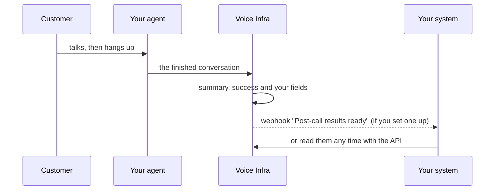

A few seconds after the hangup the results are on the call. A call that never
connected, such as one nobody answered, has no conversation to read, so its
results are skipped.

---

## Part 1: Set it up in the console

### 1. Open your agent

Open **Agent Studio** and click the agent you want results from.

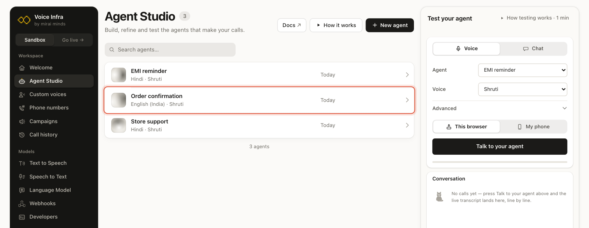

Making a new agent? Click **New agent**, create it, and carry on from step 2.

### 2. Open Post-call results and turn it on

In the agent's menu on the left, click **Post-call results**. Then switch
**Enabled** on.

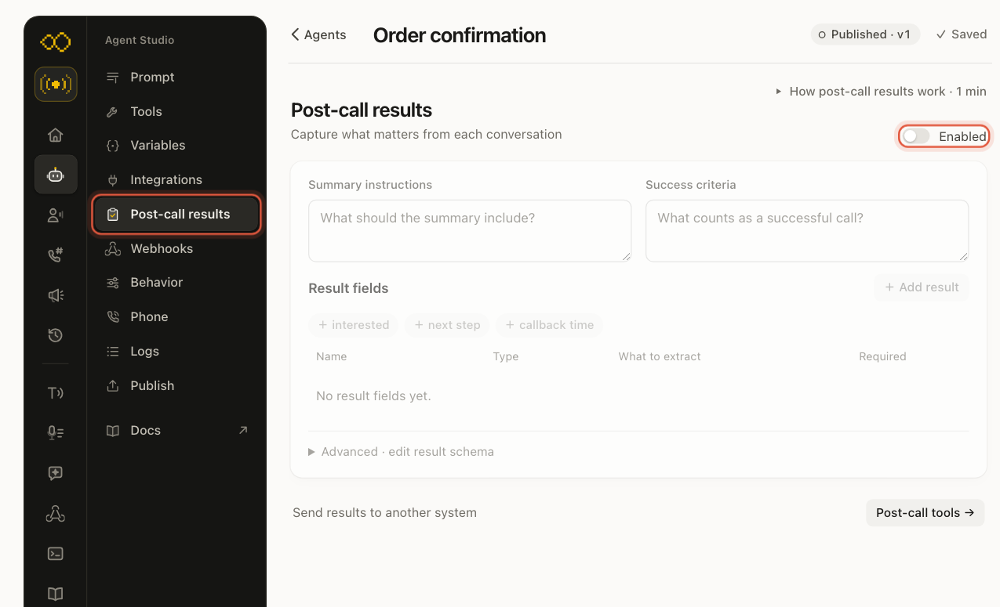

### 3. Say what you want back

Fill in three things. Write them the way you'd brief a new colleague.

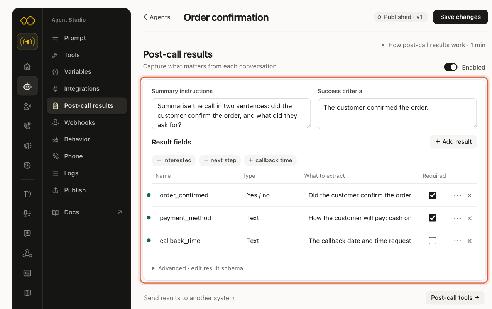

**Summary instructions.** What the summary should cover. For example:
"Summarise the call in two sentences: did the customer confirm the order, and
what did they ask for?"

**Success criteria.** What makes a call a success for you. For example: "The
customer confirmed the order." Each call is then marked **Successful** or
**Not successful**. When the conversation doesn't make it clear, it's left
blank.

**Result fields.** The facts you want pulled out of every call. Click
**＋ Add result** for each one, or click a suggestion such as **＋ callback
time**. Each field has:

| Column | What to put |
| :--- | :--- |
| **Name** | A short name your team will recognise, in letters, numbers and underscores: `order_confirmed`. This is also the name your systems see. |
| **Type** | **Text** for words, **Yes / no** for a yes or no question, **Number** for amounts, **Whole number** for counts. |
| **What to extract** | The question, in plain words: "Did the customer confirm the order?" |
| **Required** | Tick it when every call should answer this. Leave it off for things that only come up sometimes, like a call-back time. |

If the customer never said it, the field comes back as **unknown**.

<Tip>
Start with two or three fields. You can add more once you see real results.
</Tip>

### 4. Save

Click **Save changes** at the top of the page.

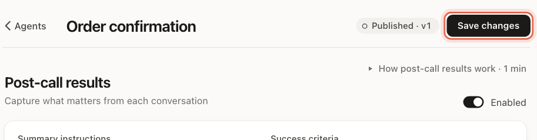

The button turns to **Saved** and the version number goes up by one. Every
call from now on gets post-call results.

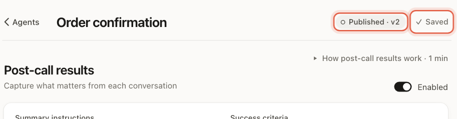

### 5. Test it

You don't need a phone call to try it. In **Test your agent** on the right,
choose **Chat** and press **Start chat**.

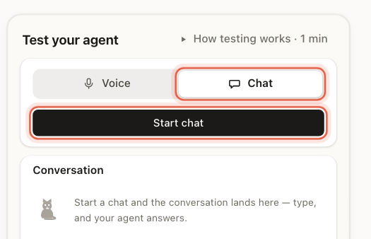

Type a short conversation as if you were the customer. When the agent ends the
chat, or you press **End chat**, a **Post-call results** card appears under the
conversation. It says "Analysing the call…" for a few seconds, then shows the
result.

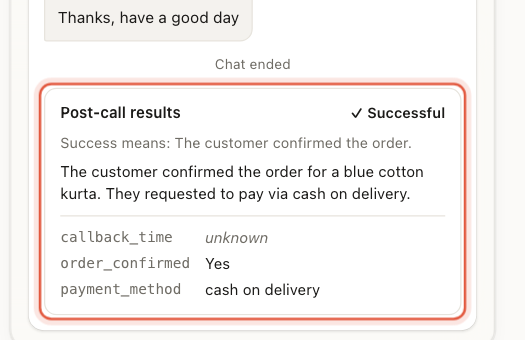

A test call with **Voice** shows the same card when you hang up.

### 6. Find the results later

Every call keeps its results. Open **Call history**, click a call, and open
**Post-call results** in the panel on the right.

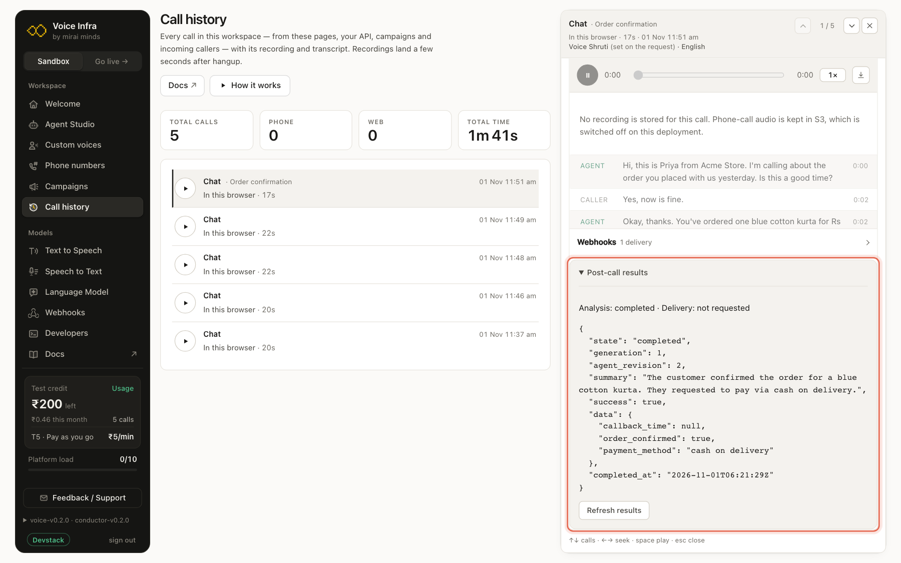

`success` is `true` for a successful call, `false` for one that wasn't, and
`null` when it couldn't be told. `data` holds your fields; `null` there is the
same as **unknown**. The **Delivery** line is about a `webhook_url` you send
with a call from the API. Webhooks you set up on the agent, as in
[Part 3](#part-3-send-the-results-to-your-system), are counted in the
**Webhooks** row just above it.

Results also show in a campaign's **Result** column, so you can see how each
contact's call went.

<Accordion title="If the card says 'No summary or extracted fields for this agent'">
Post-call results are off for that agent, or the change wasn't saved. Open
**Post-call results**, check **Enabled** is on, and click **Save changes**.
Then start a new test.
</Accordion>

---

## Part 2: Do the same with the API

Everything above is one setting on the agent called `analysis`. The console
writes it for you; from your backend you send it yourself.

### 1. Set your host and key

| Workspace | API base URL |
| :--- | :--- |
| Production (live) | `https://prod.voice.miraiminds.co` |
| Sandbox (trial) | `https://sandbox.voice.miraiminds.co` |

```bash
export MIRAI_API="https://sandbox.voice.miraiminds.co"
export MIRAI_API_KEY="sk_live_YOUR_API_KEY"
```

Keep the key on your server. It never goes in a web page or a mobile app.

### 2. Add results to an agent you already have

Find the agent's id (`agt_…`) on its page in the console or with
[`GET /v2/agents`](/v2/agents#list-agents). Then send `analysis` with
`PATCH /v2/agents/{id}`:

<CodeGroup>
```bash cURL
curl -X PATCH "$MIRAI_API/v2/agents/agt_01M6AW976AVW3ZGE4EPSF2RYX0" \
  -H "Authorization: Bearer $MIRAI_API_KEY" \
  -H "Content-Type: application/json" \
  -d '{
    "analysis": {
      "enabled": true,
      "prompt": "Summarise the call in two sentences: did the customer confirm the order, and what did they ask for?",
      "success_criteria": "The customer confirmed the order.",
      "output_schema": {
        "type": "object",
        "properties": {
          "order_confirmed": {
            "type": ["boolean", "null"],
            "description": "Did the customer confirm the order?"
          },
          "payment_method": {
            "type": ["string", "null"],
            "description": "How the customer will pay: cash on delivery or online"
          },
          "callback_time": {
            "type": ["string", "null"],
            "description": "The callback date and time requested by the caller."
          }
        },
        "required": ["order_confirmed", "payment_method"]
      }
    }
  }'
```

```python Python
import os, httpx

API = os.environ["MIRAI_API"]
auth = {"Authorization": f"Bearer {os.environ['MIRAI_API_KEY']}"}

analysis = {
    "enabled": True,
    "prompt": "Summarise the call in two sentences: did the customer confirm the order, and what did they ask for?",
    "success_criteria": "The customer confirmed the order.",
    "output_schema": {
        "type": "object",
        "properties": {
            "order_confirmed": {"type": ["boolean", "null"], "description": "Did the customer confirm the order?"},
            "payment_method": {"type": ["string", "null"], "description": "How the customer will pay: cash on delivery or online"},
            "callback_time": {"type": ["string", "null"], "description": "The callback date and time requested by the caller."},
        },
        "required": ["order_confirmed", "payment_method"],
    },
}

agent = httpx.patch(
    f"{API}/v2/agents/agt_01M6AW976AVW3ZGE4EPSF2RYX0",
    headers=auth,
    json={"analysis": analysis},
    timeout=30,
).raise_for_status().json()
print(agent["revision"], agent["analysis"]["enabled"])
```

```javascript Node.js
const API = process.env.MIRAI_API;
const auth = { Authorization: `Bearer ${process.env.MIRAI_API_KEY}` };

const analysis = {
  enabled: true,
  prompt: "Summarise the call in two sentences: did the customer confirm the order, and what did they ask for?",
  success_criteria: "The customer confirmed the order.",
  output_schema: {
    type: "object",
    properties: {
      order_confirmed: { type: ["boolean", "null"], description: "Did the customer confirm the order?" },
      payment_method: { type: ["string", "null"], description: "How the customer will pay: cash on delivery or online" },
      callback_time: { type: ["string", "null"], description: "The callback date and time requested by the caller." },
    },
    required: ["order_confirmed", "payment_method"],
  },
};

const res = await fetch(`${API}/v2/agents/agt_01M6AW976AVW3ZGE4EPSF2RYX0`, {
  method: "PATCH",
  headers: { ...auth, "Content-Type": "application/json" },
  body: JSON.stringify({ analysis }),
});
if (!res.ok) throw new Error(JSON.stringify(await res.json()));
const agent = await res.json();
console.log(agent.revision, agent.analysis.enabled);
```
</CodeGroup>

The answer is the updated agent with a new `revision`. Only `analysis` changes;
the prompt, voice, tools and everything else stay as they were.

<Warning>
`PATCH` replaces the whole `analysis` object. If the agent already has
post-call results and you only want to add a field, read the agent first with
`GET /v2/agents/{id}`, change its `analysis`, and send all of it back.
Otherwise the fields you left out are removed.
</Warning>

This is exactly what the console saves. Here is how its form maps to the API:

| In the console | In `analysis` |
| :--- | :--- |
| **Enabled** | `enabled: true` |
| **Summary instructions** | `prompt`, up to 2,000 characters |
| **Success criteria** | `success_criteria`, up to 2,000 characters |
| A result field's **Name** | a key under `output_schema.properties`, up to 32 fields |
| **Type**: Text, Number, Whole number, Yes / no | `"string"`, `"number"`, `"integer"`, `"boolean"` |
| **What to extract** | that field's `description` |
| **Required** ticked | the name is listed in `output_schema.required` |
| A field can be **unknown** | `"null"` is in its `type`, as in `["string", "null"]`. The console adds it to every field. |

### 3. Or set it when you create the agent

Put the same `analysis` object in [`POST /v2/agents`](/v2/agents#create-an-agent),
next to the rest of the agent:

```json
{
  "name": "Order confirmation",
  "system_prompt": "You are Priya from Acme Store. You call customers to confirm the order they placed on the website…",
  "first_message": "Hi, this is Priya from Acme Store. I'm calling about the order you placed with us yesterday. Is this a good time?",
  "voice": { "voice_id": "shruti", "language": "en-IN" },
  "language": "en-IN",
  "analysis": {
    "enabled": true,
    "prompt": "Summarise the call in two sentences: did the customer confirm the order, and what did they ask for?",
    "success_criteria": "The customer confirmed the order.",
    "output_schema": { "type": "object", "properties": { "…": "the same fields as above" } }
  }
}
```

### 4. Read the results of a call

When a call has finished, read its results with
[`GET /v2/calls/{id}/analysis`](/api-reference/calls/get-call-analysis):

```bash
curl "$MIRAI_API/v2/calls/call_01M6AW9SKY964TZGQTD76GZDG6/analysis" \
  -H "Authorization: Bearer $MIRAI_API_KEY"
```

```json title="200 OK"
{
  "call_id": "call_01M6AW9SKY964TZGQTD76GZDG6",
  "analysis": {
    "state": "completed",
    "generation": 1,
    "agent_revision": 2,
    "summary": "The customer confirmed the order for a blue cotton kurta. They requested to pay via cash on delivery.",
    "success": true,
    "data": {
      "callback_time": null,
      "order_confirmed": true,
      "payment_method": "cash on delivery"
    },
    "completed_at": "2026-11-01T06:21:29Z"
  },
  "delivery": { "state": "not_requested", "event_id": "evt_01M6AWAAN3JD0FDQPZH7MPARJK", "attempts": 0 }
}
```

| Field | What it means |
| :--- | :--- |
| `state` | `pending` or `processing` while it runs, then `completed`, `failed` or `skipped`. `skipped` means results are off for the agent, or the call never connected. |
| `summary` | The summary, written to your summary instructions. |
| `success` | `true`, `false`, or `null` when the conversation didn't make it clear. |
| `data` | Your result fields by name. `null` means the customer never said it. |
| `agent_revision` | The agent version the call ran on, so you know which settings produced it. |

The same `analysis` object is on the call itself in
[`GET /v2/calls/{id}`](/v2/calls#get-a-call). To have each result sent to you
when it's ready, set up a webhook as in Part 3.

If `state` is `failed`, run it again with
`POST /v2/calls/{id}/analysis/retry` and the body
`{"if_generation": 1}`, using the `generation` you just read.

### 5. Turn it off

Send `"analysis": { "enabled": false }`, or `"analysis": null`, with
`PATCH /v2/agents/{id}`. Calls placed after that have no post-call results.

---

## Part 3: Send the results to your system

A webhook is a message we send to an address of yours each time something
happens. Subscribe to **Post-call results ready** (`call.analysis.completed`)
and your system gets the summary, the success verdict and your fields a few
seconds after every call, without asking.

### In the console

#### 1. Open Webhooks on the agent

On the same agent, click **Webhooks** in the
menu and switch on **Send call results to your system**.

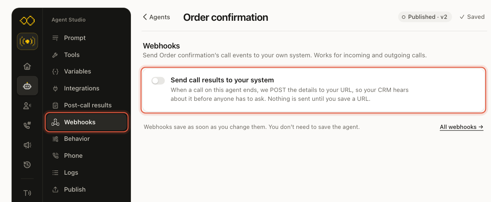

#### 2. Paste your URL

It must be a public `https://` address. In these
screenshots we used `https://postman-echo.com/post`, a free test address that
accepts any request. Use your own.

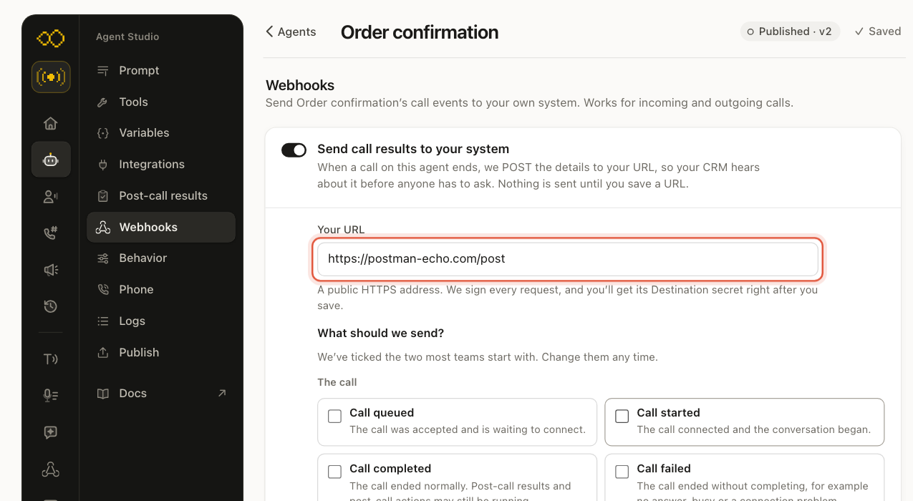

#### 3. Choose what to send

Two events are ticked to start with. For post-call
results, tick **Post-call results ready** under **Post-call results**. Untick
anything you don't need. Then click **Save webhook**.

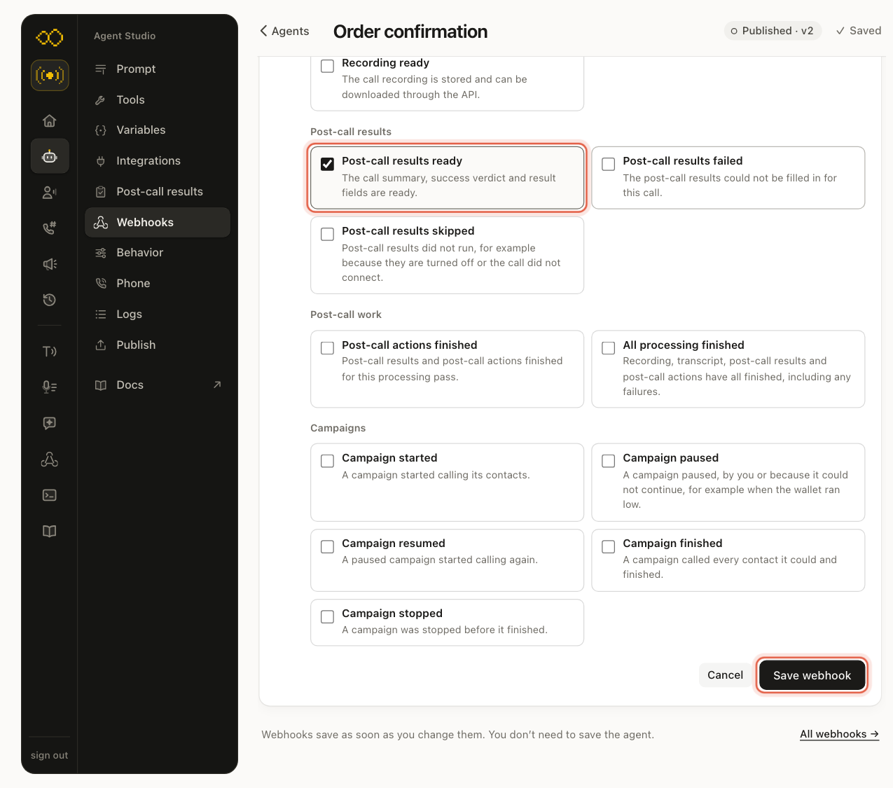

The other events in that group are **Post-call results failed** and
**Post-call results skipped**, if you also want to hear about calls that had
no result.

#### 4. Copy the secret

Right after you save, we show the **Destination
secret** once. Copy it and keep it on your server with your other keys. You
use it to check that a request really came from us (see
[Check the signature](#check-the-signature) below). Tick **I have saved this
secret securely** and click **Done**.

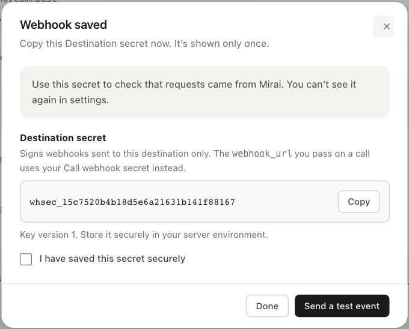

#### 5. Make a call and watch it arrive

Run a test chat or call, as in
[Part 1, step 5](#5-test-it). Back on **Webhooks**, the delivery shows under
**Recent deliveries** with its status.

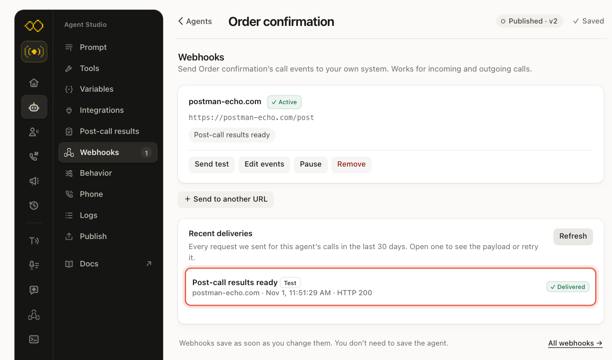

Click a delivery to see exactly what we sent and what your server answered.

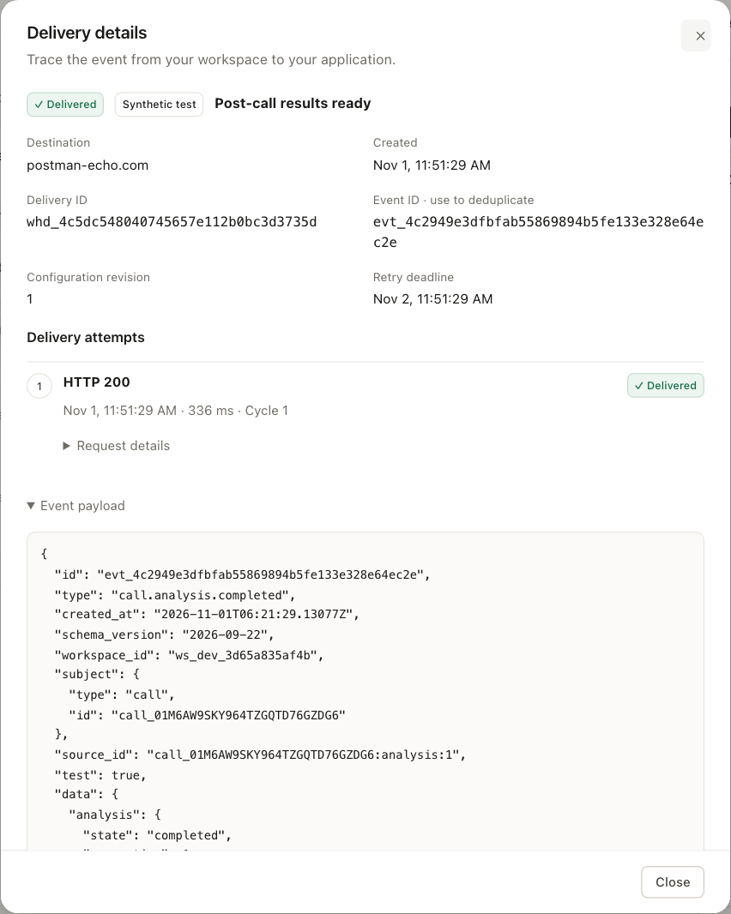

Deliveries from a test chat or test call are marked **Test**, and their
payload says `"test": true`, so your system can keep them apart from real
calls.

A webhook set up on the agent saves straight away; you don't need to click
**Save changes** on the agent. To send the same events for every agent in the
workspace, use **Webhooks** in the main menu instead.

### With the API

The console steps above make two things: an **endpoint** (your URL) and a
**subscription** (which events, for which agent). The API makes the same two.

#### 1. Create the endpoint

```bash
curl "$MIRAI_API/v2/webhooks/endpoints" \
  -H "Authorization: Bearer $MIRAI_API_KEY" \
  -H "Content-Type: application/json" \
  -d '{"name": "Order system", "url": "https://your-app.example.com/webhooks/mirai"}'
```

```json title="201 Created"
{
  "id": "whe_b68befa1261011a8ecec7aba721eb97a",
  "object": "webhook_endpoint",
  "name": "Order system",
  "url": "https://your-app.example.com/webhooks/mirai",
  "enabled": true,
  "revision": 1,
  "signing_secret": "whsec_…",
  "signing_key_version": 1
}
```

`signing_secret` is shown only in this answer. Store it now.

#### 2. Subscribe it to Post-call results ready for your agent

```bash
curl "$MIRAI_API/v2/webhooks/subscriptions" \
  -H "Authorization: Bearer $MIRAI_API_KEY" \
  -H "Content-Type: application/json" \
  -d '{
    "endpoint_id": "whe_b68befa1261011a8ecec7aba721eb97a",
    "scope": { "type": "agent", "agent_id": "agt_01M6AW976AVW3ZGE4EPSF2RYX0" },
    "event_types": ["call.analysis.completed"]
  }'
```

For every agent in the workspace, use `"scope": { "type": "workspace" }`.

#### 3. Send yourself a test

```bash
curl "$MIRAI_API/v2/webhooks/endpoints/whe_b68befa1261011a8ecec7aba721eb97a/test" \
  -H "Authorization: Bearer $MIRAI_API_KEY" \
  -H "Content-Type: application/json" \
  -d '{"if_revision": 1, "event_type": "call.analysis.completed"}'
```

See [Webhook subscriptions](/v2/webhook-subscriptions) for every endpoint,
delivery history and retries.

### What we send

Each result arrives as a signed `POST` with a JSON body like this one. The
results are in `data.analysis`:

```json
{
  "id": "evt_4c2949e3dfbfab55869894b5fe133e328e64ec2e",
  "type": "call.analysis.completed",
  "created_at": "2026-11-01T06:21:29.13077Z",
  "schema_version": "2026-09-22",
  "workspace_id": "ws_8c2e…",
  "subject": { "type": "call", "id": "call_01M6AW9SKY964TZGQTD76GZDG6" },
  "source_id": "call_01M6AW9SKY964TZGQTD76GZDG6:analysis:1",
  "test": false,
  "data": {
    "analysis": {
      "state": "completed",
      "generation": 1,
      "agent_revision": 2,
      "summary": "The customer confirmed the order for a blue cotton kurta. They requested to pay via cash on delivery.",
      "success": true,
      "data": {
        "callback_time": null,
        "order_confirmed": true,
        "payment_method": "cash on delivery"
      },
      "completed_at": "2026-11-01T06:21:29Z"
    },
    "call": {
      "id": "call_01M6AW9SKY964TZGQTD76GZDG6",
      "object": "call",
      "agent_id": "agt_01M6AW976AVW3ZGE4EPSF2RYX0",
      "to": "+919876543210",
      "status": "completed",
      "duration_secs": 20,
      "…": "the rest of the call object"
    }
  }
}
```

`data.call` is the [call object](/v2/calls#the-call-object). If you placed the
call with `metadata`, such as your own order id, it's in `data.call.metadata`,
so you can match the result to the right record.

### Check the signature

Every request carries an `X-Mirai-Signature` header:

```http
X-Mirai-Signature: t=1793513489,v1=771bca27e1647dfbe59ff5d8f32d9de69be246f6e604c05bddcbaefd8604ccb3
```

`v1` is the HMAC-SHA256 of `"<t>.<raw body>"` with your destination secret.
Check it on the raw bytes before you parse the JSON, then answer `200`
quickly. Here is a complete receiver:

<CodeGroup>
```python Python (Flask)
import hashlib, hmac, json, os, time
from flask import Flask, request

app = Flask(__name__)
SECRET = os.environ["MIRAI_WEBHOOK_SECRET"]  # the whsec_… you copied
seen = set()  # use your database in production

def verified(raw: bytes, header: str) -> bool:
    parts = dict(p.split("=", 1) for p in header.split(",") if "=" in p)
    t = int(parts.get("t", "0"))
    if not t or abs(time.time() - t) > 300:
        return False
    expected = hmac.new(SECRET.encode(), f"{t}.".encode() + raw, hashlib.sha256).hexdigest()
    return hmac.compare_digest(expected, parts.get("v1", ""))

@app.post("/webhooks/mirai")
def mirai():
    raw = request.get_data()
    if not verified(raw, request.headers.get("X-Mirai-Signature", "")):
        return "bad signature", 401
    event = json.loads(raw)
    if event["id"] in seen:          # a retry of one we already handled
        return "", 200
    seen.add(event["id"])
    if event["type"] == "call.analysis.completed" and not event["test"]:
        result = event["data"]["analysis"]
        call = event["data"]["call"]
        print(call["id"], result["success"], result["summary"], result["data"])
        # save it to your CRM, sheet or database here
    return "", 200
```

```javascript Node.js (Express)
import crypto from "node:crypto";
import express from "express";

const app = express();
const SECRET = process.env.MIRAI_WEBHOOK_SECRET; // the whsec_… you copied
const seen = new Set(); // use your database in production

function verified(raw, header = "") {
  const parts = Object.fromEntries(header.split(",").map((p) => p.split("=")));
  const t = Number(parts.t);
  if (!t || Math.abs(Date.now() / 1000 - t) > 300) return false;
  const expected = crypto.createHmac("sha256", SECRET).update(`${t}.`).update(raw).digest();
  const given = Buffer.from(parts.v1 ?? "", "hex");
  return given.length === expected.length && crypto.timingSafeEqual(given, expected);
}

app.post("/webhooks/mirai", express.raw({ type: "application/json" }), (req, res) => {
  if (!verified(req.body, req.get("X-Mirai-Signature"))) return res.sendStatus(401);
  const event = JSON.parse(req.body);
  if (seen.has(event.id)) return res.sendStatus(200); // a retry of one we already handled
  seen.add(event.id);
  if (event.type === "call.analysis.completed" && !event.test) {
    const { summary, success, data } = event.data.analysis;
    console.log(event.data.call.id, success, summary, data);
    // save it to your CRM, sheet or database here
  }
  res.sendStatus(200);
});

app.listen(3000);
```
</CodeGroup>

If your server doesn't answer `2xx`, we try again with the same event `id`, so
handle each `id` once. More on secrets and retries in
[Webhook subscriptions](/v2/webhook-subscriptions#verify-the-signature).

<Note>
Already placing calls with a `webhook_url` on
[`POST /v2/calls`](/v2/calls#create-a-call)? That URL gets the results too, in
the `call.processed` event, signed with your Call webhook secret. See
[Webhooks](/v2/webhooks#final-results).
</Note>

---

## Troubleshooting

| What you see | Why, and what to do |
| :--- | :--- |
| "No summary or extracted fields for this agent" after a test | Post-call results are off or weren't saved. Switch **Enabled** on and click **Save changes**. |
| A call has no results | Results apply to calls placed after you saved. Calls that never connected (no answer, busy, voicemail) are `skipped`. |
| A field says **unknown** (`null`) | The customer didn't say it. Make the field's **What to extract** clearer, or leave **Required** off for things that only come up sometimes. |
| **Successful** looks wrong | Make the success criteria one plain sentence about the outcome you want, such as "The customer agreed to a visit date." |
| The state is `failed` | Click **Retry analysis** on the call, or use `POST /v2/calls/{id}/analysis/retry`. |
| The webhook shows **Failed** under Recent deliveries | Open the delivery to see what your server answered. It needs a public `https://` address that answers `2xx` within a few seconds. |
| Your server rejects the signature | Check the raw body, not parsed JSON, and use the destination secret (`whsec_…`) from when you saved the webhook. |

## Before you go live

- The summary instructions, success criteria and fields read well on five or
  six test chats.
- Each field your system depends on has a clear **What to extract**.
- Your webhook receiver checks the signature, handles each event `id` once,
  and ignores events with `"test": true` if you don't want test calls in your
  records.
- You read `data.call.metadata`, or the call id, to match each result to the
  right customer.
- You went live and switched to production: base URL
  `https://prod.voice.miraiminds.co` and a key from the live console. See
  [Go live](/v2/go-live).

For every field, the follow-up message picker and the errors, see
[Call analysis](/v2/analysis).
