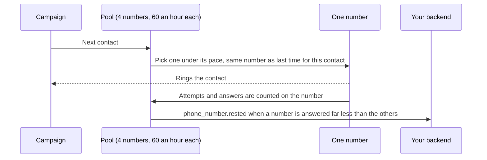

A campaign that rings everyone from one number gets that number flagged as spam,
and answers fall. This recipe builds the alternative: several of your own numbers
in a pool, a campaign that calls from the pool at a human pace, and a way to see
and react when a number stops getting answered. It suits
[renewals](https://voice.miraiminds.co/use-cases/renewal-reminders),
[payment reminders](https://voice.miraiminds.co/use-cases/payment-reminders),
winbacks and any outbound list that runs for more than a day.

## What you'll build

- A pool of three or four numbers, set to 60 calls an hour each.
- A campaign that calls from the pool, with a capacity line that tells you
  whether the pool can keep up.
- A webhook that tells your backend when a number rests or the pool runs short.
- A routine for what to do when a number rests, cools or gets retired.

You need an enabled workspace with wallet balance, a published
[agent](/v2/agents), a contact list, and your API key. If your workspace has no
numbers of its own yet, step 1 gets you some.

## How it works



The pool counts attempts and answers on each number, in India time, across every
campaign and API call that uses it. A number that has been answered less than
half as often as the pool's average, after at least 25 attempts, rests for 45
minutes and the pool keeps calling from the others. See
[Phone numbers and pools](/v2/phone-numbers) for every rule.

## Step 1: Get your numbers

You can rent numbers through Mirai or import numbers you own. Both need a few
minutes in the console and are covered in
[Receive inbound phone calls](/cookbooks/inbound-calling). For this recipe you
do not assign an agent to answer, unless you also want the numbers to take
incoming calls.

1. Open **Phone numbers → Numbers**.
2. Click **Add a number** to rent one, or **Import a number** for one you own.
3. Repeat until you have the numbers you want. A pool of three or four is a good
   start.

A new number is **Warming up** for its first 7 days. It calls at half the pool's
pace until then, so it eases in. Check what you have:

<Tabs>
  <Tab title="cURL">
    ```bash
    curl https://sandbox.voice.miraiminds.co/v2/phone-numbers \
      -H "Authorization: Bearer $MIRAI_API_KEY" |
      jq '.data[] | {id, number, state, health: .health.state}'
    ```
  </Tab>
  <Tab title="Python">
    ```python
    import os, httpx

    API = "https://sandbox.voice.miraiminds.co"
    auth = {"Authorization": f"Bearer {os.environ['MIRAI_API_KEY']}"}

    numbers = httpx.get(f"{API}/v2/phone-numbers", headers=auth, timeout=30)
    numbers.raise_for_status()
    for n in numbers.json()["data"]:
        print(n["id"], n["number"], n["state"], n["health"]["state"])
    ```
  </Tab>
  <Tab title="Node.js">
    ```javascript
    const API = "https://sandbox.voice.miraiminds.co";
    const auth = { Authorization: `Bearer ${process.env.MIRAI_API_KEY}` };

    const res = await fetch(`${API}/v2/phone-numbers`, { headers: auth });
    if (!res.ok) throw new Error(`List numbers failed: ${res.status}`);
    for (const n of (await res.json()).data) {
      console.log(n.id, n.number, n.state, n.health.state);
    }
    ```
  </Tab>
</Tabs>

Only numbers with `state: "ready"` on a `verified` connection, inside their
rental term, can join a pool.

<Warning>
Promotional calls from regular mobile numbers can be flagged more often than
calls from a number series meant for them. We do not sell that series yet.
Keep promotional lists small and watch each number's answer rate.
</Warning>

## Step 2: Make a pool

### In the console

1. Open **Phone numbers → Pools** and click **New pool**.
2. Give it a name and a purpose. **Outreach** and **Reminders** start at 60 an
   hour. **Support** starts at 40.
3. Tick the numbers. Each shows its status word and its 7 day answer rate.
   Retired numbers cannot join.
4. Set the pace. The line under the control reads like
   `3 numbers × 60 = 180 attempts an hour`. Above 60 it warns that a number is
   more likely to be flagged as spam and answered less. Above 120 it tells you
   most sales desks never run this fast and numbers will rest often.
5. Open **Advanced** if you want to change retries from the same number, automatic
   resting, the smallest number of healthy numbers the pool wants, or whether
   this is the default pool for new campaigns.
6. Click **Create**.

### With the API

<Tabs>
  <Tab title="cURL">
    ```bash
    curl -X POST https://sandbox.voice.miraiminds.co/v2/phone-pools \
      -H "Authorization: Bearer $MIRAI_API_KEY" \
      -H "Content-Type: application/json" \
      -d '{
        "name": "Renewals outreach",
        "purpose": "outreach",
        "number_ids": ["phn_01K8F2R4T6V8W0X2Y4Z6A8B0CD", "phn_01K8F2R5V7W9X1Y3Z5A7B9C1DE", "phn_01K8F2R6W8X0Y2Z4A6B8C0D2EF"],
        "max_per_hour": 60,
        "max_per_day": 400
      }'
    ```
  </Tab>
  <Tab title="Python">
    ```python
    pool = httpx.post(
        f"{API}/v2/phone-pools",
        headers=auth,
        json={
            "name": "Renewals outreach",
            "purpose": "outreach",
            "number_ids": [
                "phn_01K8F2R4T6V8W0X2Y4Z6A8B0CD",
                "phn_01K8F2R5V7W9X1Y3Z5A7B9C1DE",
                "phn_01K8F2R6W8X0Y2Z4A6B8C0D2EF",
            ],
            "max_per_hour": 60,
            "max_per_day": 400,
        },
        timeout=30,
    )
    pool.raise_for_status()
    POOL_ID = pool.json()["id"]
    ```
  </Tab>
  <Tab title="Node.js">
    ```javascript
    const res = await fetch(`${API}/v2/phone-pools`, {
      method: "POST",
      headers: { ...auth, "Content-Type": "application/json" },
      body: JSON.stringify({
        name: "Renewals outreach",
        purpose: "outreach",
        number_ids: [
          "phn_01K8F2R4T6V8W0X2Y4Z6A8B0CD",
          "phn_01K8F2R5V7W9X1Y3Z5A7B9C1DE",
          "phn_01K8F2R6W8X0Y2Z4A6B8C0D2EF",
        ],
        max_per_hour: 60,
        max_per_day: 400,
      }),
    });
    if (!res.ok) throw new Error(`Create pool failed: ${res.status}`);
    const POOL_ID = (await res.json()).id;
    ```
  </Tab>
</Tabs>

The answer is `201` with the pool, its `members` and their health. Keep the
`id`. A pool needs at least one member that can call now. If you get
`invalid_request`, `error.message` names the number to fix.

## Step 3: Point a campaign at the pool

### In the console

In the campaign form, open **Calls come from**. The list shows your pools first,
then your numbers with how each is doing, and last the Mirai shared line. Pick
the pool. When you choose nothing, the campaign uses its agent's choice, then your
workspace's default pool, then the shared line, and the form says which one it
used.

Under the picker, read the capacity line. It compares what the campaign will
try with what the pool can carry. If **Calls at once** is higher than the pool
can keep up with, it suggests a lower number.

### With the API

Send `pool_id` when you create the campaign. See
[Campaigns](/v2/campaigns#create-a-campaign) for the other fields.

<Tabs>
  <Tab title="cURL">
    ```bash
    curl -X POST https://sandbox.voice.miraiminds.co/v2/campaigns \
      -H "Authorization: Bearer $MIRAI_API_KEY" \
      -H "Content-Type: application/json" \
      -d '{
        "name": "October renewals",
        "agent_id": "agt_01K7Q9F3K7M2N5P9R4T6V8W0XZ",
        "pool_id": "pool_01K8F3M2Q6S8T0V2X4Z6A8C0EG",
        "timezone": "Asia/Kolkata",
        "start_date": "2026-10-19",
        "end_date": "2026-10-23",
        "slots": [{ "start": "10:00", "end": "19:00" }],
        "max_concurrent": 2,
        "retry_count": 2,
        "re_attempt_period_secs": 3600,
        "webhook_url": "https://example.com/mirai/webhook",
        "contacts": [
          { "id": "cust-1001", "phone": "+919876543210", "variables": { "customer_name": "Rohit Sharma" } }
        ]
      }'
    ```
  </Tab>
  <Tab title="Python">
    ```python
    campaign = httpx.post(
        f"{API}/v2/campaigns",
        headers=auth,
        json={
            "name": "October renewals",
            "agent_id": "agt_01K7Q9F3K7M2N5P9R4T6V8W0XZ",
            "pool_id": POOL_ID,
            "timezone": "Asia/Kolkata",
            "start_date": "2026-10-19",
            "end_date": "2026-10-23",
            "slots": [{"start": "10:00", "end": "19:00"}],
            "max_concurrent": 2,
            "retry_count": 2,
            "re_attempt_period_secs": 3600,
            "webhook_url": "https://example.com/mirai/webhook",
            "contacts": [
                {"id": "cust-1001", "phone": "+919876543210",
                 "variables": {"customer_name": "Rohit Sharma"}},
            ],
        },
        timeout=30,
    )
    campaign.raise_for_status()
    print(campaign.json()["calls_from"])
    ```
  </Tab>
  <Tab title="Node.js">
    ```javascript
    const res = await fetch(`${API}/v2/campaigns`, {
      method: "POST",
      headers: { ...auth, "Content-Type": "application/json" },
      body: JSON.stringify({
        name: "October renewals",
        agent_id: "agt_01K7Q9F3K7M2N5P9R4T6V8W0XZ",
        pool_id: POOL_ID,
        timezone: "Asia/Kolkata",
        start_date: "2026-10-19",
        end_date: "2026-10-23",
        slots: [{ start: "10:00", end: "19:00" }],
        max_concurrent: 2,
        retry_count: 2,
        re_attempt_period_secs: 3600,
        webhook_url: "https://example.com/mirai/webhook",
        contacts: [
          { id: "cust-1001", phone: "+919876543210", variables: { customer_name: "Rohit Sharma" } },
        ],
      }),
    });
    if (!res.ok) throw new Error(`Create campaign failed: ${res.status}`);
    console.log((await res.json()).calls_from);
    ```
  </Tab>
</Tabs>

The campaign object answers with `pool_id` and a `calls_from` object:

```json
{
  "source": "campaign",
  "pool_id": "pool_01K8F3M2Q6S8T0V2X4Z6A8C0EG",
  "pool_name": "Renewals outreach",
  "numbers": 3,
  "healthy": 3,
  "phone_number_id": null,
  "number": null
}
```

Start the campaign with [`POST /v2/campaigns/{id}/start`](/v2/campaigns#start-a-campaign).
A campaign calls from one source at a time. Sending `pool_id` together with
`phone_number_id` or `caller_ids` answers `400 invalid_request`.

With `max_concurrent: 2` and calls that last about 40 seconds, the campaign tries
at most 180 times an hour, and three numbers at 60 can carry exactly that. Raise
`max_concurrent` to 4 and the campaign would try 360, double what the pool can
carry. The pool then holds contacts back for the next free number, so the
campaign takes longer rather than calling faster.

## Step 4: Watch health

### In the console

**Phone numbers → Numbers** shows each number with a status word, its attempts
this hour against its pace, and a 7 day answer rate with seven small bars. A day
without calls is a gap. **Phone numbers → Pools** shows each pool with its size,
how many numbers are healthy and resting, its pace and its answer rate. Open a
pool to see its health first, with a 30 day chart and each number below it.

The status words are **Live**, **Warming up**, **Resting**, **Cooling** and
**Retired**. They are explained in
[Phone numbers and pools](/v2/phone-numbers#health).

### With the API

<Tabs>
  <Tab title="cURL">
    ```bash
    curl https://sandbox.voice.miraiminds.co/v2/phone-pools/$POOL_ID \
      -H "Authorization: Bearer $MIRAI_API_KEY" |
      jq '{numbers, healthy, resting, answer_rate_7d,
           members: [.members[] | {number, state: .health.state,
             attempts_this_hour: .health.attempts_this_hour,
             answer_rate_7d: .health.answer_rate_7d}]}'
    ```
  </Tab>
  <Tab title="Python">
    ```python
    pool = httpx.get(f"{API}/v2/phone-pools/{POOL_ID}", headers=auth, timeout=30).json()
    print(pool["healthy"], "of", pool["numbers"], "can call")
    for m in pool["members"]:
        h = m["health"]
        print(m["number"], h["state"], h["attempts_this_hour"], h["answer_rate_7d"])
    ```
  </Tab>
  <Tab title="Node.js">
    ```javascript
    const pool = await fetch(`${API}/v2/phone-pools/${POOL_ID}`, { headers: auth })
      .then((r) => r.json());
    console.log(pool.healthy, "of", pool.numbers, "can call");
    for (const m of pool.members) {
      const h = m.health;
      console.log(m.number, h.state, h.attempts_this_hour, h.answer_rate_7d);
    }
    ```
  </Tab>
</Tabs>

For one number's last 30 days and today's hours, use
`GET /v2/phone-numbers/{id}/health`.

### Be told when something changes

The campaign's `webhook_url` receives `phone_number.rested`,
`phone_number.cooling`, `phone_number.alert`, `phone_number.resumed` and
`phone_pool.degraded`, signed like every other [webhook](/v2/webhooks). Each one
carries the full number or pool and a `reason` written for people. Only
campaigns that are running or paused and use the pool, or a number in it, get
them. A pool that no campaign uses does not send events.

A small handler is enough to start. Verify the signature first, as described in
[Webhooks](/v2/webhooks#signature-verification).

```python
def on_event(event):
    t, data = event["type"], event["data"]
    if t == "phone_pool.degraded":
        pool = data["phone_pool"]
        page_the_owner(f"{pool['name']}: {pool['healthy']} of {pool['numbers']} numbers can call. {data['reason']}")
    elif t in ("phone_number.rested", "phone_number.cooling", "phone_number.alert"):
        n = data["phone_number"]
        log_for_review(n["number"], t, data["reason"])
```

## When a number rests

A resting number is the pool working as intended. It rested because people were
answering it far less than the pool's other numbers.

1. Check the other numbers. If the pool is healthy, do nothing. The number comes
   back by itself in 45 minutes.
2. Look at the number's 7 day answer rate. If it was already falling before it
   rested, the number is probably being flagged. Lower the pool's pace or add
   numbers, and retire this number if its rate keeps falling.
3. If the number rested three times in a day, it is **Cooling** for 7 hours and
   stays out until you resume it. Let it cool. Resume it early only when
   you have a reason, such as a list that looked cold rather than a number that
   looked burnt.
4. A pool with fewer healthy numbers than its `min_healthy` is degraded. Add a
   number to it, or resume one.

To rest, resume or retire a number yourself, use the row's **Rest…** or **Resume**
action in **Phone numbers → Numbers**. Each leaves a notice with **Undo**. Through
the API:

```bash
# rest for an hour
curl -X POST https://sandbox.voice.miraiminds.co/v2/phone-numbers/phn_01K8F2R4T6V8W0X2Y4Z6A8B0CD/rest \
  -H "Authorization: Bearer $MIRAI_API_KEY" \
  -H "Content-Type: application/json" -d '{ "minutes": 60 }'

# bring it back now
curl -X POST https://sandbox.voice.miraiminds.co/v2/phone-numbers/phn_01K8F2R4T6V8W0X2Y4Z6A8B0CD/resume \
  -H "Authorization: Bearer $MIRAI_API_KEY"
```

A retired number takes no outbound calls and still rings your agent when someone
calls it. Resume brings it back.

## Test it

Use a short list and a low pace so every behaviour shows within a few minutes.

1. Make a pool of two numbers with `max_per_hour: 6`, `max_per_day: 400`, and
   `min_healthy: 2`.
2. Create a campaign on it with a list of 20 numbers you can reach, then start it.
3. Open **Phone numbers → Numbers**. Each number's attempts this hour should stop
   at 6, and the campaign should wait for the next hour. A number added in the
   last 7 days is warming up and stops at half the pace, so expect 3.
4. Rest one number for an hour. Calls continue from the other, and the rested
   number shows **Resting** with the time it is back.
5. Resume it, then check that `phone_pool.degraded` reached your webhook while it
   was resting, because the pool wanted two healthy numbers and had one.

| Symptom | Cause | Fix |
| :--- | :--- | :--- |
| `400 invalid_request` when creating a pool, naming a number | The number is retired, not ready, or not yours | Resume or finish setting it up, or leave it out |
| `409 pool_unavailable` when creating or starting a campaign | Every number in the pool is unable to call | Add a ready number, or resume one |
| Campaign is `paused` with `calls_from_unavailable` | The pool has no number left that can call | Fix the pool or the number, then [resume](/v2/campaigns#resume-a-campaign) |
| Campaign is running but dialling slowly | Calls at once is higher than the pool can carry, so contacts wait for the next free number | Lower `max_concurrent`, add numbers, or raise the pace with care |
| `409 pool_in_use` when deleting a pool | A campaign or agent still calls from it | Move them first, using the names in the message |
| `409 pool_busy` on `POST /v2/calls` | Every number is resting or at its pace this hour | Retry after `Retry-After`, or raise the pace |
| No webhook for a rest | No running or paused campaign uses the number or its pool, or it has no `webhook_url` | Set a `webhook_url` on a campaign that uses the pool |

## Privacy and compliance

Calling lists carry people's phone numbers and often their names. Keep contact
lists, transcripts and recordings behind your own access controls, and apply your
retention rules.

Follow the calling rules for your market, such as the do-not-call registry in
India and consent requirements. Keep your [do-not-call list](/v2/dnc) up to date.
The pace of a pool changes how many calls go out, and it does not change what you
are allowed to call. A pool does not make a campaign compliant.

Tell people they are speaking with an AI voice agent, and give recording notices
where they apply. Each person sees the number they are called from, so use
numbers that you can answer when they call back, and point those numbers at an
agent.

## Production checklist

- Each number you rely on is `ready`, and its rental is in term.
- The pool's pace is at or below 60 an hour unless you have chosen otherwise, and
  the capacity line shows it can carry the campaign's calls at once.
- `min_healthy` matches the number of numbers you need to run.
- The campaign's `webhook_url` verifies signatures, dedupes on `id`, and tells a
  person when a pool is degraded.
- Someone knows what to do when a number cools, and who can resume or retire it.
- You have a default pool or an agent `calls_from`, so a campaign never falls to
  the shared line by accident.

## Related

<CardGroup cols={2}>
  <Card title="Phone numbers and pools" icon="phone" href="/v2/phone-numbers">
    Every field, health state, event and error code.
  </Card>
  <Card title="Campaigns" icon="list-check" href="/v2/campaigns">
    Calling windows, retries, budget and the report.
  </Card>
  <Card title="Webhooks" icon="webhook" href="/v2/webhooks">
    Verify signatures and handle retries.
  </Card>
  <Card title="Receive inbound phone calls" icon="phone-arrow-down-left" href="/cookbooks/inbound-calling">
    Rent or import a number and make it answer.
  </Card>
</CardGroup>
