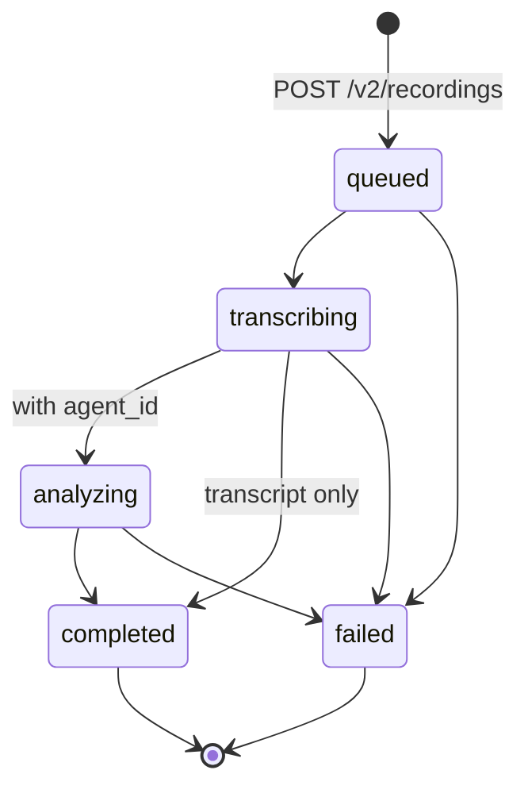

Send us a recording of a conversation that already happened: two people on a
phone call, a sales visit, a support call from another dialler. You get back
what a [call analysis](/v2/analysis) gives you after a live call ends: a
transcript with speakers and timestamps, a summary, a `success` verdict and
the fields your agent extracts.

It runs in the background. You get an `id` straight away, then read the
recording with `GET` until it finishes, or let a webhook tell you.

Base URL `https://sandbox.voice.miraiminds.co`. Every request carries
`Authorization: Bearer sk_live_…`, your workspace API key. A recording belongs
to the workspace whose key sent it.

<Tip>
**Which one do I use?**

| You want | Use |
| :--- | :--- |
| A transcript and the analysis your agent would give it: summary, success and fields | This page |
| Only a transcript of a recording, with more transcription options | [Transcriptions](/v2/transcriptions) |
| The analysis of a call one of your Mirai voice agents made | That call's own [analysis](/v2/analysis#where-the-result-appears). You don't need to upload its recording. |
</Tip>

## Transcript only, or with insight

| You send | You get | Price per minute of audio |
| :--- | :--- | :--- |
| No `agent_id` | The transcript | ₹0.30 |
| An `agent_id` | The transcript, plus **insight**: the summary and the post-call analysis that agent is set up for | ₹0.50 (₹0.30 transcription + ₹0.20 insight) |

Insight uses the agent's [analysis settings](/v2/analysis#turn-it-on): its
`prompt`, `success_criteria` and `output_schema`. So the result has the same
shape as that agent's live calls, and one agent can analyse both. The agent
must have analysis turned on. If it doesn't, the request is refused with
`400 analysis_disabled`. Turn analysis on, or leave out `agent_id` to get only
the transcript.

A recording has no call variables, so any `{{variables}}` in the agent's
analysis `prompt` or `success_criteria` are left empty.

## How it works



1. **Queued.** The recording waits for a free slot. Uploads run with their own
   capacity, separate from live calls, so a large batch never slows your
   agents' calls down. While it waits, `queue_position` says about how many
   recordings are ahead of it.
2. **Transcribing.** A long recording is cut into parts at quiet moments, the
   parts are transcribed a few at a time, and the transcript is joined back
   together by timestamp. `progress` counts the parts.
3. **Analyzing.** With an `agent_id`, the transcript is analysed with that
   agent's analysis settings.
4. **Completed** or **failed.** A failure says which stage it happened in.

The audio is deleted once the transcript is stored. A retried analysis reads
the stored transcript and never transcribes the recording again.

### How long it takes

<Note>
These are estimates, not measurements: about 1 to 3 minutes for a 5-minute
recording, and about 8 to 20 minutes for a 60-minute one. It takes longer when
other uploads are queued ahead of yours. Poll every 10 to 30 seconds, or use a
webhook.
</Note>

## Send a recording

```http
POST /v2/recordings
```

Send the recording in one of two ways:

- As `multipart/form-data` with the file in `file`. Up to 45 MB.
- As `application/json` with an `https` `recording_url` that we fetch. Up to
  200 MB.

### Upload a file

| Field | Required | Description |
| :--- | :--- | :--- |
| `file` | yes | The recording. One file per request. |
| `agent_id` | no | `agt_…`. With it, insight runs with this agent's analysis settings. Without it, you get the transcript only. |
| `language` | no | `auto` (default) detects the main language. Or `hi`, `gu`, `en`, `mr`, `pa`, `bn`, `ta`, `te`, `kn`, `ml`, `ur` when you know it. |
| `recorded_at` | no | When the conversation happened, in RFC 3339, such as `2026-11-14T16:05:00+05:30`. It helps the analysis turn "tomorrow" or "Saturday" into a real date. |
| `webhook_url` | no | An `https` URL that receives the result. See [webhooks](#get-the-result-by-webhook). |
| `metadata` | no | A JSON object, as text, of your own string values. Up to 16 keys, the same rules as a call's [metadata](/v2/calls#metadata). It comes back on the recording and in the webhook. |

Any other form field is refused with `400 invalid_request`.

<Tabs>
  <Tab title="cURL">
    ```bash
    curl -X POST https://sandbox.voice.miraiminds.co/v2/recordings \
      -H "Authorization: Bearer $MIRAI_API_KEY" \
      -H "Idempotency-Key: call-2026-11-14-0412" \
      -F file=@call-0412.wav \
      -F agent_id=agt_01JZQ8F3K7M2N5P9R4T6V8W0XZ \
      -F recorded_at=2026-11-14T16:05:00+05:30 \
      -F metadata='{"crm_id": "L-2231"}'
    ```
  </Tab>
  <Tab title="Python">
    ```python
    import json
    import os

    import httpx

    API = "https://sandbox.voice.miraiminds.co"
    auth = {"Authorization": f"Bearer {os.environ['MIRAI_API_KEY']}"}

    with open("call-0412.wav", "rb") as f:
        r = httpx.post(
            f"{API}/v2/recordings",
            headers={**auth, "Idempotency-Key": "call-2026-11-14-0412"},
            files={"file": ("call-0412.wav", f, "audio/wav")},
            data={
                "agent_id": "agt_01JZQ8F3K7M2N5P9R4T6V8W0XZ",
                "recorded_at": "2026-11-14T16:05:00+05:30",
                "metadata": json.dumps({"crm_id": "L-2231"}),
            },
            timeout=600,  # the answer comes after the whole file is uploaded
        )
    recording = r.json()
    if r.status_code != 202:
        raise RuntimeError(f"{recording['error']['code']}: {recording['error']['message']}")
    print(recording["id"], recording["status"])  # rec_01JDX3K6Y8M2N4P6Q8R0S2T4V6 queued
    ```
  </Tab>
  <Tab title="Node.js">
    ```javascript
    import { readFile } from "node:fs/promises";

    const API = "https://sandbox.voice.miraiminds.co";
    const auth = { Authorization: `Bearer ${process.env.MIRAI_API_KEY}` };

    const form = new FormData();
    form.append("file", new Blob([await readFile("call-0412.wav")], { type: "audio/wav" }), "call-0412.wav");
    form.append("agent_id", "agt_01JZQ8F3K7M2N5P9R4T6V8W0XZ");
    form.append("recorded_at", "2026-11-14T16:05:00+05:30");
    form.append("metadata", JSON.stringify({ crm_id: "L-2231" }));

    const res = await fetch(`${API}/v2/recordings`, {
      method: "POST",
      headers: { ...auth, "Idempotency-Key": "call-2026-11-14-0412" },
      body: form,
    });
    const recording = await res.json();
    if (res.status !== 202) throw new Error(`${recording.error.code}: ${recording.error.message}`);
    console.log(recording.id, recording.status); // rec_01JDX3K6Y8M2N4P6Q8R0S2T4V6 queued
    ```
  </Tab>
</Tabs>

### Send a link

The same fields as JSON, with `recording_url` in place of the file and
`metadata` as an object.

| Field | Required | Description |
| :--- | :--- | :--- |
| `recording_url` | yes | An `https` link to the recording, such as a pre-signed link to your storage. |
| `agent_id`, `language`, `recorded_at`, `webhook_url`, `metadata` | no | As for an upload. |

The link must point to a public address on the default `https` port (443),
with no user name or password in it. Redirects are followed to `https`
addresses only, at most 5 of them, and each one is checked the same way. If
the link is pre-signed, give it at least 15 minutes to live.

<Tabs>
  <Tab title="cURL">
    ```bash
    curl -X POST https://sandbox.voice.miraiminds.co/v2/recordings \
      -H "Authorization: Bearer $MIRAI_API_KEY" \
      -H "Content-Type: application/json" \
      -H "Idempotency-Key: call-2026-11-14-0413" \
      -d '{
        "recording_url": "https://storage.example.com/calls/0413.mp3?X-Amz-Expires=900&X-Amz-Signature=…",
        "agent_id": "agt_01JZQ8F3K7M2N5P9R4T6V8W0XZ",
        "language": "hi",
        "webhook_url": "https://api.example.com/mirai/recordings",
        "metadata": { "crm_id": "L-2232" }
      }'
    ```
  </Tab>
  <Tab title="Python">
    ```python
    r = httpx.post(
        f"{API}/v2/recordings",
        headers={**auth, "Idempotency-Key": "call-2026-11-14-0413"},
        json={
            "recording_url": presigned_url,  # from your storage
            "agent_id": "agt_01JZQ8F3K7M2N5P9R4T6V8W0XZ",
            "language": "hi",
            "webhook_url": "https://api.example.com/mirai/recordings",
            "metadata": {"crm_id": "L-2232"},
        },
        timeout=600,
    )
    recording = r.json()
    if r.status_code != 202:
        raise RuntimeError(f"{recording['error']['code']}: {recording['error']['message']}")
    ```
  </Tab>
  <Tab title="Node.js">
    ```javascript
    const res = await fetch(`${API}/v2/recordings`, {
      method: "POST",
      headers: { ...auth, "Content-Type": "application/json", "Idempotency-Key": "call-2026-11-14-0413" },
      body: JSON.stringify({
        recording_url: presignedUrl, // from your storage
        agent_id: "agt_01JZQ8F3K7M2N5P9R4T6V8W0XZ",
        language: "hi",
        webhook_url: "https://api.example.com/mirai/recordings",
        metadata: { crm_id: "L-2232" },
      }),
    });
    const recording = await res.json();
    if (res.status !== 202) throw new Error(`${recording.error.code}: ${recording.error.message}`);
    ```
  </Tab>
</Tabs>

### Response

`202 Accepted`, with a `Location` header and the recording:

```http
Location: /v2/recordings/rec_01JDX3K6Y8M2N4P6Q8R0S2T4V6
```

```json title="202 Accepted"
{
  "id": "rec_01JDX3K6Y8M2N4P6Q8R0S2T4V6",
  "object": "recording",
  "status": "queued",
  "insight": true,
  "agent_id": "agt_01JZQ8F3K7M2N5P9R4T6V8W0XZ",
  "agent_revision": 4,
  "source": "upload",
  "file_name": "call-0412.wav",
  "bytes": 2380044,
  "duration_secs": 312.4,
  "channels": 2,
  "speakers": null,
  "language": null,
  "detected_language": null,
  "recorded_at": "2026-11-14T10:35:00Z",
  "metadata": { "crm_id": "L-2231" },
  "created_at": "2026-11-17T10:02:11Z",
  "started_at": null,
  "transcribed_at": null,
  "completed_at": null,
  "queue_position": 0,
  "progress": null,
  "error": null,
  "cost": {
    "transcription": { "status": "pending", "amount_inr": null, "amount_paise": null, "rate_inr_per_minute": 0.3 },
    "insight": { "status": "pending", "amount_inr": null, "amount_paise": null, "rate_inr_per_minute": 0.2 },
    "amount_inr": 0,
    "amount_paise": 0
  }
}
```

### Idempotency

Send an `Idempotency-Key` header (up to 255 characters) with a value from your
own records, such as your call ID. A request with a key your workspace has
already used returns the recording that key created. It makes no second job
and no second charge, so a request that timed out is safe to send again.

## Get a recording

```http
GET /v2/recordings/{id}
```

Read it until `status` is `completed` or `failed`.

<Tabs>
  <Tab title="cURL">
    ```bash
    curl https://sandbox.voice.miraiminds.co/v2/recordings/rec_01JDX3K6Y8M2N4P6Q8R0S2T4V6 \
      -H "Authorization: Bearer $MIRAI_API_KEY"
    ```
  </Tab>
  <Tab title="Python">
    ```python
    import time

    def wait_for(recording_id: str) -> dict:
        while True:
            recording = httpx.get(f"{API}/v2/recordings/{recording_id}", headers=auth, timeout=30).json()
            if recording["status"] in ("completed", "failed"):
                return recording
            time.sleep(15)

    recording = wait_for("rec_01JDX3K6Y8M2N4P6Q8R0S2T4V6")
    if recording["status"] == "failed":
        print(recording["error"]["stage"], recording["error"]["code"], recording["error"]["message"])
    else:
        print(recording["analysis"]["summary"])
        print(recording["analysis"]["data"])
    ```
  </Tab>
  <Tab title="Node.js">
    ```javascript
    async function waitFor(recordingId) {
      for (;;) {
        const res = await fetch(`${API}/v2/recordings/${recordingId}`, { headers: auth });
        const recording = await res.json();
        if (recording.status === "completed" || recording.status === "failed") return recording;
        await new Promise((resolve) => setTimeout(resolve, 15000));
      }
    }

    const recording = await waitFor("rec_01JDX3K6Y8M2N4P6Q8R0S2T4V6");
    if (recording.status === "failed") {
      console.log(recording.error.stage, recording.error.code, recording.error.message);
    } else {
      console.log(recording.analysis.summary, recording.analysis.data);
    }
    ```
  </Tab>
</Tabs>

A completed recording with insight:

```json title="200 OK"
{
  "id": "rec_01JDX3K6Y8M2N4P6Q8R0S2T4V6",
  "object": "recording",
  "status": "completed",
  "insight": true,
  "agent_id": "agt_01JZQ8F3K7M2N5P9R4T6V8W0XZ",
  "agent_revision": 4,
  "source": "upload",
  "file_name": "call-0412.wav",
  "bytes": 2380044,
  "duration_secs": 312.4,
  "channels": 2,
  "speakers": "channels",
  "language": null,
  "detected_language": "hi",
  "recorded_at": "2026-11-14T10:35:00Z",
  "metadata": { "crm_id": "L-2231" },
  "created_at": "2026-11-17T10:02:11Z",
  "started_at": "2026-11-17T10:02:14Z",
  "transcribed_at": "2026-11-17T10:03:40Z",
  "completed_at": "2026-11-17T10:03:52Z",
  "queue_position": null,
  "progress": null,
  "transcript": [
    { "speaker": "Speaker 1", "start_ms": 0, "end_ms": 4210, "text": "नमस्ते, मैं Mira Motors से बोल रही हूँ, आपकी service booking के बारे में।" },
    { "speaker": "Speaker 2", "start_ms": 4800, "end_ms": 7350, "text": "हाँ बोलिए, Saturday को आ सकता हूँ क्या?" }
  ],
  "analysis": {
    "state": "completed",
    "generation": 1,
    "agent_revision": 4,
    "summary": "The customer booked a service for Saturday morning and asked for a pickup.",
    "success": true,
    "data": { "service_date": "2026-11-15", "pickup_requested": true },
    "completed_at": "2026-11-17T10:03:52Z"
  },
  "delivery": { "state": "delivered", "event_id": "evt_01JDX3QH1R3T5V7X9Z1B3D5F7H", "attempts": 1 },
  "error": null,
  "cost": {
    "transcription": { "status": "charged", "amount_inr": 1.57, "amount_paise": 157, "rate_inr_per_minute": 0.3 },
    "insight": { "status": "charged", "amount_inr": 1.05, "amount_paise": 105, "rate_inr_per_minute": 0.2 },
    "amount_inr": 2.62,
    "amount_paise": 262
  }
}
```

### The recording object

| Field | Type | Description |
| :--- | :--- | :--- |
| `id` | string | `rec_` and 26 characters. |
| `object` | string | Always `recording`. |
| `status` | enum | `queued`, `transcribing`, `analyzing`, `completed` or `failed`. See [statuses](#statuses). |
| `insight` | boolean | `true` when you sent an `agent_id`, so the summary and analysis run. |
| `agent_id` | string \| null | The agent whose analysis settings are used. `null` for a transcript only. |
| `agent_revision` | integer \| null | The agent's revision when you sent the recording. Later edits to the agent don't change this recording's analysis. |
| `source` | enum | `upload` for a file, `url` for a link we fetched. |
| `file_name` | string | The uploaded file's name, or the last part of the link's path. |
| `bytes` | integer | Size of the recording. |
| `duration_secs` | number \| null | Length of the recording in seconds. `null` until it is measured. |
| `channels` | integer \| null | `1` or `2`. `null` until it is measured. |
| `speakers` | enum \| null | How the speakers were told apart: `channels`, `diarized` or `unlabelled`. `null` until the recording is transcribed. See [speakers](#speakers). |
| `language` | string \| null | The language you set, or `null` for automatic detection. |
| `detected_language` | string \| null | The main language spoken, as a short code such as `hi` or `en`. `null` until the recording is transcribed. |
| `recorded_at` | string \| null | The time you sent, or `null`. |
| `metadata` | object | What you sent. Absent when you sent none. |
| `created_at` | string | When the recording was accepted. |
| `started_at` | string \| null | When it left the queue. |
| `transcribed_at` | string \| null | When the transcript was ready. |
| `completed_at` | string \| null | When it completed or failed. |
| `queue_position` | integer \| null | While `queued`: about how many recordings are ahead of it. `null` otherwise. |
| `progress` | object \| null | While `transcribing`: `chunks_done` and `chunks_total`, the parts of the recording transcribed so far. `null` otherwise. |
| `transcript` | array | One entry per turn: `speaker`, `start_ms`, `end_ms` (milliseconds from the start of the recording) and `text`. Once transcribed, on `GET /v2/recordings/{id}` only. |
| `analysis` | object \| null | The analysis, in the same shape as a call's: `state`, `generation`, `agent_revision`, `summary`, `success`, `data`, `error` and `completed_at`. See [call analysis](/v2/analysis#where-the-result-appears). `GET /v2/recordings/{id}` only. |
| `delivery` | object \| null | How sending the result to your `webhook_url` went: `state`, `event_id` and `attempts`. `null` when there is nothing to send. `GET /v2/recordings/{id}` only. |
| `error` | object \| null | For a failed recording: `stage` (`transcription` or `analysis`), `code` and `message`. See [why a recording failed](#why-a-recording-failed). |
| `cost` | object | What each stage cost. See [pricing](#pricing). |

`transcript`, `analysis` and `delivery` appear only when you read one
recording. The create response and [the list](#list-recordings) carry every
other field.

### Statuses

| Status | Final | Meaning |
| :--- | :---: | :--- |
| `queued` | | Accepted and waiting for a slot. `queue_position` says about how many are ahead. |
| `transcribing` | | Being transcribed. `progress` counts the parts done. |
| `analyzing` | | The transcript is ready, and the analysis is running. Only with insight. |
| `completed` | Yes | The transcript, and with insight the analysis, are ready. |
| `failed` | Yes | `error.stage` says whether transcription or analysis failed. A failed stage is not charged. |

Statuses only move forward, except that [retrying a failed analysis](#retry-a-failed-analysis)
moves the recording back to `analyzing`. `started_at`, `transcribed_at` and
`completed_at` show where the time went.

### Speakers

| `speakers` | When | Labels in `transcript` |
| :--- | :--- | :--- |
| `channels` | A two-channel recording, such as most call-centre recordings with one side on each channel. Each channel is transcribed on its own. | `Speaker 1` for the first channel, `Speaker 2` for the second. |
| `diarized` | One channel. The voices were told apart automatically. | `Agent` and `Customer` when their roles were recognised, otherwise `Speaker 1`, `Speaker 2` and so on. |
| `unlabelled` | One channel, and the voices could not be told apart. | Every line is `Speaker`. Nothing is guessed. |

A two-channel file whose channels are identical, or with one channel silent,
is treated as one channel. With `unlabelled`, the analysis is told that the
lines are not labelled, so it does not credit a statement to a particular
person unless the words make it clear.

## Get the result by webhook

When a recording finishes, we send one signed `POST` to its `webhook_url`, and
the same event to your [webhook subscriptions](/v2/webhook-subscriptions). It
is the same event, with the same shape and the same
[signature](/v2/webhooks#signature-verification), as a live call's analysis:

| Event | When |
| :--- | :--- |
| `call.analysis.completed` | The insight is ready. |
| `call.analysis.failed` | Transcription or analysis failed. `data.call.analysis.error.code` says why. |
| `call.analysis.skipped` | A transcript-only recording finished. `data.call.analysis.error.code` is `analysis_not_requested`. |

`data.call.source` is `upload`, and `data.call.id` is the recording's `id`.
That is how you tell a recording's result from a live call's.

```json title="call.analysis.completed"
{
  "id": "evt_01JDX3QH1R3T5V7X9Z1B3D5F7H",
  "type": "call.analysis.completed",
  "created_at": "2026-11-17T10:03:52Z",
  "data": {
    "call": {
      "id": "rec_01JDX3K6Y8M2N4P6Q8R0S2T4V6",
      "object": "call",
      "source": "upload",
      "agent_id": "agt_01JZQ8F3K7M2N5P9R4T6V8W0XZ",
      "agent_revision": 4,
      "status": "completed",
      "created_at": "2026-11-17T10:02:11Z",
      "started_at": "2026-11-17T10:02:14Z",
      "ended_at": "2026-11-17T10:03:52Z",
      "duration_secs": 312,
      "metadata": { "crm_id": "L-2231" },
      "cost": {
        "amount_inr": 2.62,
        "amount_paise": 262,
        "per_min_inr": 0.5,
        "per_min_paise": 50,
        "insights_per_min_inr": 0.2,
        "insights_per_min_paise": 20
      },
      "analysis": {
        "status": "done",
        "state": "completed",
        "generation": 1,
        "agent_revision": 4,
        "summary": "The customer booked a service for Saturday morning and asked for a pickup.",
        "success": true,
        "data": { "service_date": "2026-11-15", "pickup_requested": true },
        "completed_at": "2026-11-17T10:03:52Z"
      }
    }
  }
}
```

The transcript is not in the event. Read it with
[`GET /v2/recordings/{id}`](#get-a-recording). Treat the event as additive:
new fields can appear, so ignore what you don't recognise. Deliveries are
[retried](/v2/webhooks#retries) like a call's, and `delivery` on the recording
says how it went.

## List recordings

```http
GET /v2/recordings
```

Your workspace's recordings, newest first, without `transcript`, `analysis`
and `delivery`.

| Query | Description |
| :--- | :--- |
| `limit` | 1 to 100. |
| `cursor` | `next_cursor` from the previous page. |

```json title="200 OK"
{
  "object": "list",
  "data": [
    { "id": "rec_01JDX3K6Y8M2N4P6Q8R0S2T4V6", "object": "recording", "status": "completed", "insight": true, "...": "..." }
  ],
  "has_more": false,
  "next_cursor": null
}
```

## Retry a failed analysis

If a recording failed in the `analysis` stage, run the analysis again:

```http
POST /v2/recordings/{id}/analysis/retry
```

```json
{ "if_generation": 1 }
```

Send the `analysis.generation` you read. The answer is `202` with the
recording, now `analyzing`. The retry uses the stored transcript, so the
recording is not transcribed again, and transcription is not charged again.
Insight is charged once, when an analysis completes, however many times you
retry. If the analysis has not failed, or someone retried it already, the
answer is `409 conflict`: read the recording again first.

A recording that failed in the `transcription` stage cannot be retried. Send
it again.

## Pricing

| Stage | Price | Charged when |
| :--- | :--- | :--- |
| Transcription | ₹0.30 per minute of audio | The transcript is ready |
| Insight (summary and analysis) | ₹0.20 per minute of audio | The analysis completes |
| Both | ₹0.50 per minute of audio | |

- Each stage is billed per second of audio, rounded up to the next second
  with a one-second minimum, and the amount is rounded up to the paisa.
- Each stage is charged once, only when it succeeds. A failed stage is free.
- Retrying an analysis never charges it twice.
- When you send a recording, your wallet must hold enough for the whole
  recording: ₹0.30 a minute for a transcript only, ₹0.50 a minute with
  insight. If it doesn't, you get `402 insufficient_balance`, and the message
  says how much is needed. Nothing is held: the charges come when the stages
  finish.

A 5 minute 12.4 second recording with insight is billed as 313 seconds:
transcription ₹1.57 and insight ₹1.05, ₹2.62 in all. A 10-minute recording
with insight costs ₹5.00. All prices exclude GST.

The charges appear in [wallet transactions](/v2/wallet#list-transactions)
with kind `recording`, the recording's `id` as `reference`, and descriptions
such as "Recording transcription · 5m13s of audio" and "Recording insight ·
5m13s of audio".

`cost` on the recording:

| Field | Description |
| :--- | :--- |
| `transcription`, `insight` | Each has `status`, `amount_inr`, `amount_paise` and `rate_inr_per_minute`. `status` is `pending` until the stage finishes (the amounts are `null`), then `charged`, or `free` when the stage failed (`0`). `insight` is `not_requested` (`0`) for a transcript only. |
| `amount_inr`, `amount_paise` | What has been charged so far, in all. |

## Limits

| Thing | Limit |
| :--- | :--- |
| Length | 60 minutes. A longer recording is refused with `400 audio_too_long`. |
| Formats | Any common audio format: WAV, MP3, M4A and MP4, OGG and Opus, WebM, FLAC, AAC, AMR and others. Otherwise `400 unsupported_audio`. |
| Channels | One or two. More than two is `400 unsupported_audio`. |
| Uploaded file | 45 MB. Over it, `413 request_too_large`. Send a larger file by link. |
| File at `recording_url` | 200 MB. Over it, `413 request_too_large`. |
| In the queue | 20 recordings per workspace, queued or in progress. Over it, `429 at_capacity` with `Retry-After: 60`. |
| New recordings | 120 per hour per workspace. Over it, `429 rate_limited` with `Retry-After`. |
| `metadata` | 16 keys, string values, the same rules as a call's [metadata](/v2/limits#payload-and-duration-ceilings). |
| `Idempotency-Key` | 255 characters. |

## Errors

### When you send a recording

| Status | `error.code` | Cause |
| :--- | :--- | :--- |
| `400` | `invalid_request` | The body is neither multipart nor JSON, has no `file` or `recording_url`, has an unknown field, or a field is not valid: `language`, `recorded_at`, `webhook_url` or `metadata`. `error.message` names the problem. |
| `400` | `unsupported_audio` | The file is not audio we can decode, or it has more than two channels. |
| `400` | `audio_too_long` | The recording is longer than 60 minutes. |
| `400` | `analysis_disabled` | The agent has analysis turned off. Turn it on, or leave out `agent_id` for a transcript only. |
| `401` | `unauthorized` | Missing or unknown API key. |
| `402` | `insufficient_balance` | The wallet does not cover the recording's estimated cost. Nothing was charged. [Add credit](/v2/wallet#top-up) and send it again with the same `Idempotency-Key`. |
| `404` | `not_found` | `agent_id` is not an agent in this workspace. |
| `409` | `agent_archived` | The agent is archived. Restore it first. |
| `413` | `request_too_large` | The upload is over 45 MB, or the file at `recording_url` is over 200 MB. |
| `429` | `at_capacity` | Your workspace already has 20 recordings queued or in progress. `Retry-After: 60`. |
| `429` | `rate_limited` | Your workspace has sent 120 recordings in the past hour. `Retry-After` says when to try again. |
| `503` | `upstream_unavailable` | The service is unavailable right now. Nothing was charged. Try again shortly. |
| `503` | `recording_unavailable` | Recording analysis is not available on this deployment. |

### Why a recording failed

| `error.stage` | `error.code` | What to do |
| :--- | :--- | :--- |
| `transcription` | `unsupported_audio` | The file could not be decoded. Check that it plays, then send it again in another format, such as WAV or MP3. |
| `transcription` | `audio_too_long` | The recording measured longer than 60 minutes. Split it and send the parts. |
| `transcription` | `no_speech` | No speech was found in the recording. Check that it is the right file. |
| `transcription` | `transcription_failed` | The recording could not be transcribed. Check that it has clear speech, then send it again. |
| `transcription` | `transcription_unavailable` | A problem on our side, not with the recording. Send it again in a few minutes. |
| `transcription` | `timed_out` | It did not finish in time. Send it again. |
| `analysis` | `analysis_failed` | The analysis could not complete. [Retry it](#retry-a-failed-analysis). |

A failed stage is never charged. Branch on `error.code`, allow for codes not
listed here, and show `error.message` if you need a sentence for a person.

## Privacy and your data

- The audio is deleted once the transcript is stored.
- The transcript and analysis stay with the recording, so that
  `GET /v2/recordings/{id}` can return them.
- Recordings often hold personal details of people who are not your
  customers yet. Make sure the people in a recording were told it may be
  recorded and analysed, as your local rules require.

## Related

- [Call analysis](/v2/analysis): set up the summary, success criteria and fields an agent extracts.
- [Webhooks](/v2/webhooks): verify signatures and handle retries.
- [Transcriptions](/v2/transcriptions): transcripts only, with vocabulary and word timings.
